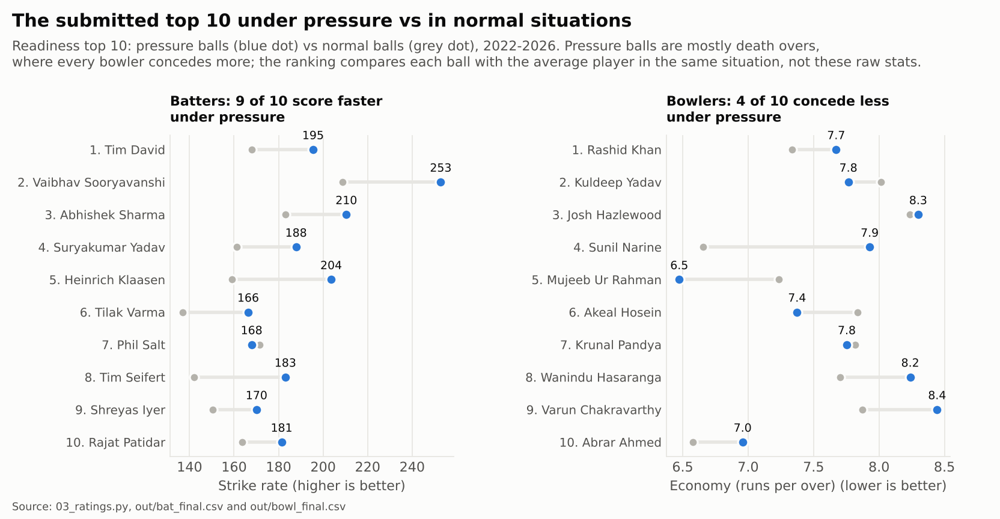
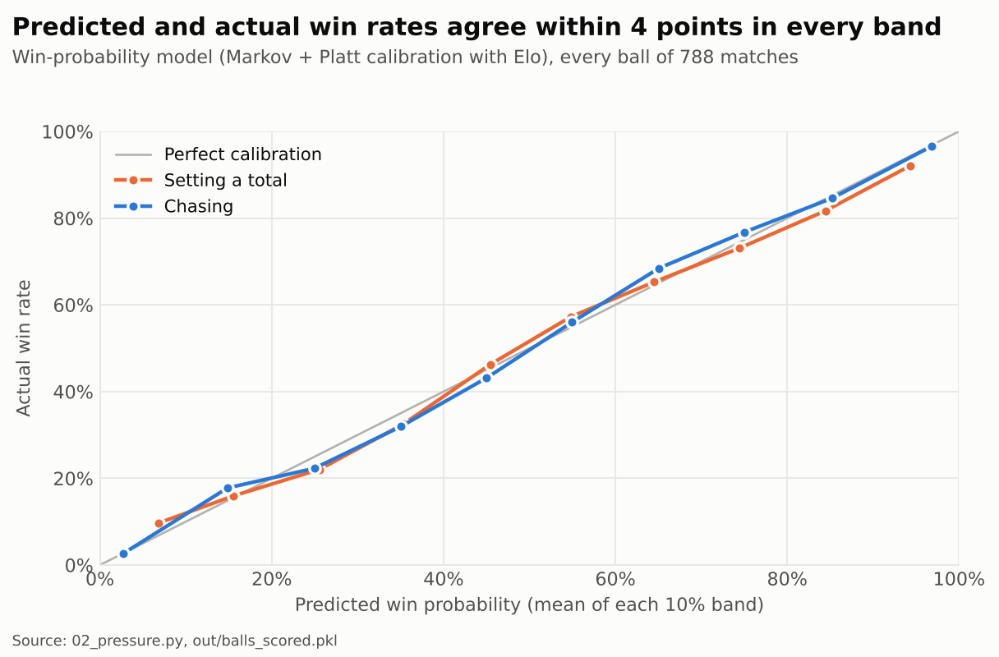
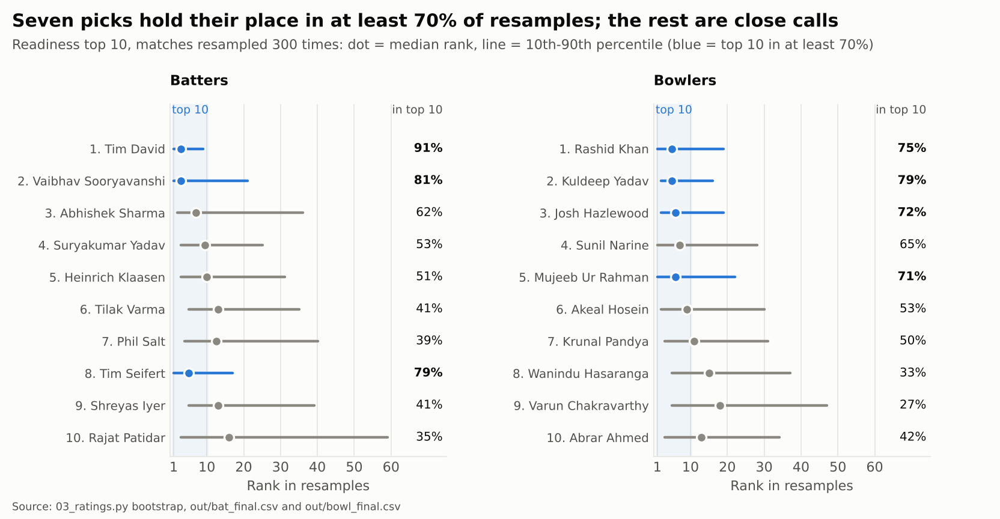
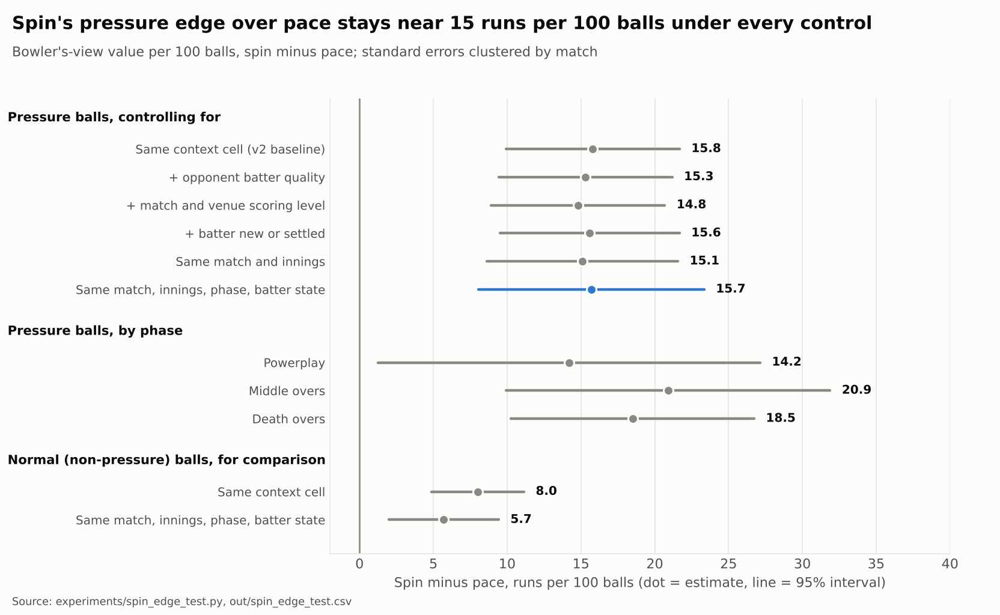

# SupeRR Selector Season 2 — Who Delivers Under Pressure?

A data-driven system that rates IPL and T20I batters and bowlers in **high-pressure match situations** against how an average player performs in the same situation. It produces two separate ratings and a ranked top 10 of each.

Built for Round 1 of Rajasthan Royals' *SupeRR Selector Season 2* using only the supplied data pack: 883 matches from January 2022 to 1 November 2026 and 201k deliveries. The analysis was rerun on the updated ball-by-ball dataset published during Round 1: the file at the update link is byte-for-byte identical to the one used here (MD5 `c5bbd29fe98b35a46d83c7dc7072a27d`).

---

## Final rankings

Two ratings answer two different questions. They are never combined into one score (section 5.6).

- **Current Pressure Readiness (submitted):** who is performing best under pressure now? Matches from the last 12 months count fully. Older matches count half, so they act as the starting point that recent form updates.
- **Career Pressure Ability:** who has shown the most ability under pressure across 2022–2026? Every match counts equally.

| Rank | Batter: Readiness (submitted) | Bowler: Readiness (submitted) | Batter: Career | Bowler: Career |
|---:|---|---|---|---|
| 1 | Tim David | Rashid Khan | Tim David | Rashid Khan |
| 2 | Vaibhav Sooryavanshi | Kuldeep Yadav | Vaibhav Sooryavanshi | Kuldeep Yadav |
| 3 | Abhishek Sharma | Josh Hazlewood | Suryakumar Yadav | Josh Hazlewood |
| 4 | Suryakumar Yadav | Sunil Narine | Abhishek Sharma | Sunil Narine |
| 5 | Heinrich Klaasen | Mujeeb Ur Rahman | Heinrich Klaasen | Mujeeb Ur Rahman |
| 6 | Tilak Varma | Akeal Hosein | Phil Salt | Varun Chakravarthy |
| 7 | Phil Salt | Krunal Pandya | Tim Seifert | Krunal Pandya |
| 8 | Tim Seifert | Wanindu Hasaranga | Tilak Varma | Wanindu Hasaranga |
| 9 | Shreyas Iyer | Varun Chakravarthy | Reeza Hendricks | Jasprit Bumrah |
| 10 | Rajat Patidar | Abrar Ahmed | Cameron Green | Akeal Hosein |

**Players in both top 10s** (established *and* current), the strongest picks:
- **Batters (8):** Tim David, Vaibhav Sooryavanshi, Abhishek Sharma, Suryakumar Yadav, Heinrich Klaasen, Tilak Varma, Phil Salt, Tim Seifert.
- **Bowlers (9):** Rashid Khan, Kuldeep Yadav, Josh Hazlewood, Sunil Narine, Mujeeb Ur Rahman, Akeal Hosein, Krunal Pandya, Wanindu Hasaranga, Varun Chakravarthy.

Full rankings for all 108 eligible batters and 107 eligible bowlers are in `results/bat_final.csv` and `results/bowl_final.csv` (Readiness) and `results/bat_career_final.csv` and `results/bowl_career_final.csv` (Career).




All figures are produced by `06_figures.py` (section 11) and live in `figures/`.

---

## The idea in one paragraph

Pressure is not defined by a hand-picked rule such as "required rate above 10". The system builds a **win-probability model** from the ball-by-ball data, including each team's pre-match strength. It scores every delivery with a **Leverage Index**: how much the match result can swing on that ball. The top 25% of balls by leverage in each innings are *pressure balls*. Every player is rated on the value he produces on those balls, compared with the average player in the identical situation and adjusted for the quality of the opposition (and, for batters, the type of bowling faced). Bowlers are also rated on **execution under pressure**: whether they bowl more wides, no-balls and full tosses than expected when it matters. The rating is estimated hierarchically so that small samples cannot dominate. It is computed twice: once with every match counted equally (**Career Ability**) and once with the last 12 months counted fully and older matches counted half (**Current Readiness**). Each ball is used once in each rating.

---

## Contents

1. [Pipeline overview](#1-pipeline-overview)
2. [Data cleaning](#2-data-cleaning)
3. [Win-probability model](#3-win-probability-model)
4. [Defining pressure: the Leverage Index](#4-defining-pressure-the-leverage-index)
5. [Measuring performance](#5-measuring-performance)
6. [Rating and scoring](#6-rating-and-scoring)
7. [Eligibility and fair comparison](#7-eligibility-and-fair-comparison)
8. [Validation and reliability](#8-validation-and-reliability)
9. [Model improvements tested](#9-model-improvements-tested)
10. [Limitations](#10-limitations)
11. [How to run](#11-how-to-run)
12. [Output files](#12-output-files)
13. [Repository structure](#13-repository-structure)

---

## 1. Pipeline overview

```
Data Pack CSVs
   │
   ▼
01_state.py        clean data, exclusions, match state before every ball
   │
   ▼
02_pressure.py     pre-match Elo → Markov win-probability + expected-runs model
                   → Leverage Index, pressure flags, run value, win-probability added
   │
   ▼
03_ratings.py      context residuals → batter matchup adjustment → opposition adjustment
                   → hierarchical ratings → bowler execution component → composite score
                   → done twice: Current Readiness and Career Ability
                   → split-half reliability, 300-sample bootstrap (both ratings)
   │
   ▼
04_robustness.py   sensitivity of the submitted lists to 14 alternative modelling choices,
                   pressure validation
   │
   ▼
05_final_tables.py final ranked tables for both ratings (with last team and last match)
   │
   ▼
06_figures.py      the README figures (figures/*.png)
```

---

## 2. Data cleaning

| Step | Detail |
|---|---|
| Matches in data pack | 883 |
| Removed: no result or abandoned | 41 (no winner, so no win probability to model) |
| Removed: rain-affected (revised overs or target) | 24 (DLS states do not fit a 120-ball model) |
| Removed: Emerging Teams Asia Cup 2024, Asia Cup Rising Stars 2025 | 30 (tagged `T20` but neither IPL nor full T20I) |
| Removed: super overs (innings 3–4) | 38 balls |
| **Kept** | **788 matches (357 IPL, 431 T20I), 188,151 deliveries** |

How deliveries are interpreted:

- **Illegal deliveries.** `extras_type` values `wide`, `Overstep` and `other` are not legal balls (`Overstep` and `other` are no-balls). With them removed, every complete over has exactly six legal balls.
- **Runs.** `runs` holds runs off the bat only. Extras are in `extras1_runs` and `extras_2_runs`, and an innings total is all three added together.
- **Balls faced.** A batter faces every ball except a wide.
- **Runs charged to the bowler.** Bat runs plus wide and no-ball penalty runs. Byes and leg-byes are not charged.
- **Bowler wickets.** Caught, bowled, LBW, stumped and hit wicket. Run-outs are not credited to the bowler, and *Retired Out* is not counted as a wicket.

---

## 3. Win-probability model

**File:** `02_pressure.py`

### 3.1 Model

The model has two layers.

**Layer 1 — ball-by-ball Markov model, solved by dynamic programming.**

- **States.**
  - Chasing: (balls remaining, wickets in hand, runs needed).
  - Batting first: (balls remaining, wickets in hand, runs scored).
- **Ball outcomes.** Dot, 1, 2, 3, 4, 6, wicket, wide, no-ball.
- **Outcome probabilities** are estimated from the data per:
  - **scoring environment:** IPL 2022–23, IPL 2024–26 (the Impact Player era, when scores jumped) and T20I;
  - **phase:** powerplay, middle overs or death overs;
  - **wickets in hand:** 0–10;
  - **required run rate** (8 bands), in the chase only, so batters swing harder when they need to.
- **Smoothing.** Sparse cells are smoothed towards coarser cells (wickets-in-hand band, then environment × phase) with pseudo-counts of 40 and 30.
- **Chase.** The table `V2[env, balls, wickets, need]` is solved backwards from the last ball. A wide or no-ball re-bowls the same ball. A tie after the last ball counts as 0.5 (super over).
- **First innings.** The model computes the full distribution of remaining runs from every state, then combines it with the chase table: P(win | final total T) = 1 − P(chaser wins | needs T + 1).

**Layer 2 — calibration with team strength.** One logistic regression per innings, on two inputs:

```
P(win) = sigmoid( a + b · logit(Markov probability) + c · Elo difference / 100 )
```

- **Elo difference** is the batting side's pre-match Elo minus the fielding side's. Elo starts at 1500 with K = 24, and each team is updated only *after* its match, so there is no look-ahead.
- **Fitted coefficients:**
  - 1st innings: b = 0.64, c = 0.38, a = −0.10.
  - 2nd innings: b = 0.76, c = 0.19, a = 0.40.

**Why a Markov model rather than a gradient-boosted classifier?** An earlier tree-model version (`HistGradientBoostingClassifier` with monotonic constraints) was badly wrong on rare end-of-match states: it gave 93% for "need 4 off the last ball". The dynamic-programming model is exact at the final ball, monotone by construction, and fits better.

### 3.2 Fit

| Innings | Log-loss | Brier score | AUC |
|---|---:|---:|---:|
| 1st innings (setting a total) | 0.617 | 0.214 | 0.715 |
| 2nd innings (chasing) | 0.393 | 0.128 | 0.901 |

- **Brier score** is the mean squared error of the probability (lower is better). A coin flip scores 0.25.
- **AUC** is the chance that a random winning state is rated above a random losing one (0.5 is chance, 1.0 is perfect).
- **First innings** is inherently harder to predict, because half the match is still to come.

Every version that was tried, scored in-sample:

| Model version | 1st inns log-loss | 1st inns Brier | 1st inns AUC | 2nd inns log-loss | 2nd inns Brier | 2nd inns AUC |
|---|---:|---:|---:|---:|---:|---:|
| Gradient boosting (scored out-of-fold, 5-fold grouped CV) | 0.641 | 0.223 | 0.690 | 0.407 | 0.132 | 0.894 |
| Markov, wickets in 3 bands | 0.627 | 0.219 | 0.701 | 0.399 | 0.130 | 0.897 |
| Markov, every wicket | 0.626 | 0.219 | 0.702 | 0.394 | 0.128 | 0.900 |
| **Markov, every wicket + Elo (final)** | **0.617** | **0.214** | **0.715** | **0.393** | **0.128** | **0.901** |

The gains also hold on held-out data (section 9). The Markov layer has very few free parameters (cell-level outcome frequencies), and the calibration layer has three per innings, so in-sample and held-out scores are close.

### 3.3 Calibration

Predicted and actual win rates (all balls, both innings) agree within about 3 percentage points in every 10% band:

| Predicted band | Mean predicted | Actual win rate | Balls |
|---|---:|---:|---:|
| 0–10% | 0.031 | 0.032 | 21,061 |
| 10–20% | 0.151 | 0.171 | 12,493 |
| 20–30% | 0.253 | 0.222 | 14,768 |
| 30–40% | 0.352 | 0.323 | 19,291 |
| 40–50% | 0.453 | 0.455 | 27,169 |
| 50–60% | 0.548 | 0.570 | 29,025 |
| 60–70% | 0.647 | 0.662 | 20,201 |
| 70–80% | 0.747 | 0.748 | 14,704 |
| 80–90% | 0.849 | 0.835 | 11,639 |
| 90–100% | 0.965 | 0.961 | 17,800 |

Split by innings, every band still agrees within 4 points:



### 3.4 Why Platt scaling and not isotonic regression?

The common rule of thumb says to use isotonic calibration once you have more than about 1,000 samples. It doesn't apply here, for two reasons.

1. **The independent sample size is 788, not 188,000.** Every ball in a match shares the same outcome label (who won), so the number of independent outcomes is the number of matches. With that few, isotonic regression overfits its step function. In 5-fold cross-validation grouped by match, it halved the calibration error, but it made log-loss and AUC worse and Brier no better (table in section 9).
2. **The Leverage Index needs a smooth curve.** Leverage is built from *differences* in win probability between neighbouring states. Isotonic output is a staircase: on a flat step a boundary would show zero swing, and at a jump a dot ball could look like a huge one. Platt scaling is smooth and monotone.

### 3.5 Sense checks (real chase states from the data)

| State | Win probability | Leverage Index |
|---|---:|---:|
| Need 4 off the last ball, 6 wickets in hand | 38% | 32.8 |
| Need 1 off the last ball, 3 wickets in hand | 85% | 14.6 |
| Need 10 off 6, 5 wickets in hand | 67% | 6.4 |
| Need 180 off 120, 10 wickets in hand | 47% | 1.4 |

---

## 4. Defining pressure: the Leverage Index

### 4.1 Formula

For each delivery:

```
            Σ_o  p(o | state) · | WP(state after o) − WP(state) |
LI(ball) = ─────────────────────────────────────────────────────
                       mean of the numerator over all balls
```

- `o` runs over the nine possible outcomes, and `p(o | state)` comes from the same outcome tables as the win-probability model.
- **LI = 1.0** is an average ball. **LI = 5** means the match result is five times as sensitive as usual.
- **Knockout matches** get a 1.2× stakes multiplier.
- **Team strength is included,** so a strong side chasing against a minnow is correctly less pressured.

### 4.2 Pressure threshold

A ball is a **pressure ball** if its LI is in the **top 25% for its innings** (thresholds: LI ≥ 0.92 batting first, LI ≥ 1.58 chasing).

The cut is per innings because first-innings balls move the final result less in absolute terms. A collapse while setting a total is still that innings' pressure moment, and players who mostly bat first should not be excluded.

Share of balls flagged as pressure, by phase: death overs 52%, powerplay 26%, middle overs 11%.

### 4.3 What it captures and what it ignores

- **Captures:** death overs of tight chases, powerplay collapses, first-innings death overs.
- **Ignores:** dead rubbers and lost causes. Needing 80 off 24, or defending 230 with the game won, scores near zero however frantic it looks.


### 4.4 Validation: why leverage beats a formula

A conventional index was built for comparison: required-rate ratio × wickets lost × stage of innings in the chase, and early wickets × death overs when batting first.

| Check | Leverage Index | Conventional formula |
|---|---:|---:|
| Flagged chase balls where the chasing side already had under 10% win chance | **3%** | 64% |
| Average absolute win-probability swing per ball, pressure vs other | **2.23 vs 0.94 pts (2.4×)** | 1.47 vs 1.19 pts (1.2×) |

- Share of balls flagged as pressure: 37% in close matches vs 18% in one-sided ones (260 close, 528 one-sided).
- League-wide behaviour on pressure balls vs other balls: strike rate 148 vs 137, dismissal rate 6.3% vs 5.1% of balls, dot rate 36.3% vs 37.2%.


---

## 5. Measuring performance

### 5.1 Ball value (runs currency)

The Markov model gives `ER(balls, wickets)`, the expected runs still to come from any state.

```
Batter value  = bat runs + ER(state after) − ER(state before)
Bowler value  = −[ runs charged + ER(state after, own wickets only) − ER(state before) ]
```

- A dot ball costs a little.
- A wicket in the 5th over costs 9–23 runs, more if wickets have already fallen.
- A wicket in the 19th over costs 0.5–2.5 runs.

### 5.2 Win Probability Added (WPA)

WPA is the change in win probability that is attributable to the batter (bat runs and his own dismissal) or to the bowler (runs charged and his own wickets).

### 5.3 Context residual

From every ball's value, the system subtracts the average value of all balls in the same cell:

```
scoring environment × innings × phase × wickets-in-hand band × pressure (yes/no)
```

A death-overs finisher is therefore judged against other death-overs finishers, and an opener against other openers.

### 5.4 Matchup adjustment (batters only)

Batters' residuals are further adjusted for the type of bowling faced: pace or spin × bowling arm × batter's hand (8 matchups), within each phase. The adjustment is additive, so no cell gets too thin.

Bowlers are deliberately **not** adjusted this way:

- A bowler's type is part of his own skill.
- Captains only trust their best spinners at the death.
- So comparing Rashid Khan with "spinners under pressure" compares him with an elite-only peer group and penalises the very skill being measured.
- In testing, applying it to bowlers pushed Rashid from 1st to 5th and Narine from 2nd to 4th.

### 5.5 Opposition adjustment

Batter and bowler effects are estimated together over all balls, by alternating shrunk weighted averages (3 passes):

- the batter's residual is adjusted for the bowler he faced;
- the bowler's residual is adjusted for the batter he bowled to.

This discounts runs scored against weak attacks (associate nations, part-timers) and wickets taken against weak batting.

### 5.6 Two ratings: how matches are weighted

The whole rating (sections 5.3–6.4) is computed twice, with different ball weights:

| Rating | Question | Ball weight |
|---|---|---|
| **Current Pressure Readiness** (submitted) | Who is performing best under pressure now? | **1** for balls in the last 12 months (since 1 Nov 2025); **0.5** for older balls |
| **Career Pressure Ability** | Who has shown the most ability under pressure across 2022–2026? | **1** for every ball |

**How Readiness works.** Older matches act as the starting point and the last 12 months update it. How far a player moves depends on how much recent evidence he has, because the hierarchical estimate (section 6.1) trusts a player's own record in proportion to his effective number of balls. A batter with 200 recent pressure balls moves most of the way to his recent level. One with 20 stays close to his older level, so a lucky or unlucky month cannot make or break him. A player with no older matches starts from the league prior and is rated on his recent balls.

**Each ball is counted once.** Recent form enters Readiness only through these weights. There is no separate form component (the previous version added a 25% "last 12 months" component *on top of* an 18-month recency weighting, so recent matches counted twice). The two ratings are never added together: that would count recent matches twice again.

**Why 0.5 for older balls.** It was chosen by testing 0, 0.1, 0.25, 0.5 and 1 on held-out data (section 9.2). 0.5 predicts held-out pressure performance as well as the alternatives on future seasons, and better than lower weights on held-out matches.

---

## 6. Rating and scoring

### 6.1 Hierarchical pressure rating

Raw averages on pressure balls are noisy at typical sample sizes (split-half r = 0.23 for batters). So the true pressure value `μ` is estimated from both the player's pressure record and his usual level:

```
μ̂ᵢ = β · Bᵢ + sᵢ · (P̄ᵢ − β · Bᵢ)

sᵢ  = nᵢ / (nᵢ + σ² / τ²)
```

| Symbol | Meaning |
|---|---|
| `Bᵢ` | Player's usual level: shrunk weighted average on non-pressure balls |
| `P̄ᵢ` | Raw weighted average on pressure balls (weights from section 5.6) |
| `nᵢ` | Effective number of pressure balls, `(Σw)² / Σ(w²/f)`, where `w` is the ball weight and `f` the bootstrap frequency (1 outside the bootstrap). With equal weights it is the ball count; with Readiness weights it is Kish's effective sample size |
| `σ²` | Ball-to-ball noise variance |
| `β` | How much usual level carries over to pressure |
| `τ` | Spread of true pressure-specific ability between players, in runs per 100 balls |

Fitted values:

| | Readiness: batters | Readiness: bowlers | Career: batters | Career: bowlers |
|---|---:|---:|---:|---:|
| `β` | 1.05 | 0.70 | 1.16 | 0.75 |
| `τ` | 12.8 | 10.7 | 12.4 | 9.4 |

- `β` and `τ²` are estimated from the data by weighted least squares and method of moments (empirical Bayes), separately for each rating. The shrinkage itself is not hand-tuned.
- A player with few pressure balls is rated mostly on his usual level. One with many is rated mostly on his own pressure record.
- `sᵢ · (P̄ᵢ − β·Bᵢ)` is the player's **clutch Δ**: how much better or worse he is under pressure than his usual level predicts.

### 6.2 Components

All values are in runs per 100 balls above an average player in the same situation, unless noted.

| Component | Definition |
|---|---|
| **Pressure rating** | `μ̂` above, ×100 |
| **Clutch Δ** | Shrunk pressure-specific deviation, ×100 |
| **Consistency** | Share of matches (with ≥ 3 pressure balls) whose pressure value is positive, weighted by the rating's ball weights and smoothed towards the league rate with 6 pseudo-matches |
| **Win impact** | Shrunk WPA above the context average on pressure balls, in win-probability percentage points per 10 balls |
| **Execution** (bowlers only) | How well a bowler avoids execution errors under pressure (section 6.4) |

### 6.3 Composite score

Each component is z-scored among eligible players, then combined. The weights are the same in both ratings:

| Component | Batters | Bowlers |
|---|---:|---:|
| Pressure rating | 60% | 43.9% |
| Clutch Δ | 13.3% | 16.5% |
| Consistency | 13.3% | 11.0% |
| Win impact | 13.3% | 16.5% |
| Execution | — | 12.2% |

These are the previous weights (batters 45 / 10 / 10 / 10, bowlers 36 / 13.5 / 9 / 13.5 / 10) with the separate 12-month form component (25% and 18%) removed and the rest rescaled to sum to 100%. The weights differ by role because the split-half test (section 8) found that batting clutch Δ barely repeats between samples, while bowling clutch Δ does to a useful degree. The weights are a judgement call, but the lists barely depend on them: equal weights keep 9 of 10 in both lists (section 8.3).

```
score = Σ weight_k · z_k
```

Players are ranked by `score`.

### 6.4 Execution under pressure (bowlers)

- **Execution error:** a wide, a no-ball, a full toss or a beamer. Under pressure the league-wide error rate rises from 7.6% to 11.2% of balls, and an error ball costs 79 runs per 100 balls more than other balls (t = −27).
- **Expected rate.** Pressure balls are concentrated at the death, where everyone bowls more full tosses. So each bowler's *expected* error rate and delivery mix under pressure are simulated from his own non-pressure record, re-weighted by the league-wide pressure shift for the same phase.
- **Three measures, each against that simulated expectation:**
  - **excess error rate**: actual minus expected;
  - **error z-score**: actual vs a Monte Carlo null (2,000 simulated pressure spells of the same size);
  - **delivery-mix deviation z**: Jensen–Shannon divergence between actual and expected delivery mix, against a Monte Carlo null of 200 simulations.
- **Execution** = minus the average of the three standardised measures, so higher means better execution.
- It needs at least 30 pressure and 100 other balls. Every eligible bowler qualifies.
- It is computed separately for each rating with that rating's ball weights (weighted counts, rates and simulated spell sizes), once on the full data, and held fixed in the bootstrap.

**Caveat:** full tosses are not always errors. Some bowlers (Bumrah, for example) bowl them deliberately at the death and concede little from them. The comparison with each bowler's own normal rate and the league-wide death-overs shift absorbs most of this, but not all.

---

## 7. Eligibility and fair comparison

A player is ranked only if he has:

- **≥ 120 pressure balls** faced (batters) or bowled (bowlers);
- **≥ 10 matches** with at least one pressure ball;
- **at least one appearance in the last 12 months** of the data (since 1 Nov 2025), so the lists describe players who are performing now.

That gives 108 eligible batters and 107 eligible bowlers. Eligibility uses unweighted ball and match counts, so **both ratings rank exactly the same pool of players**. A player with no recent pressure balls (for example Reeza Hendricks) is still rated in Readiness, mainly from his older matches at half weight.

How the IPL and T20I data are combined:

- Separate scoring environments are used in both the win model and the run model.
- Context residuals are computed within each environment.
- Team strength (Elo) is in the win model, and the opposition adjustment discounts weaker associate-nation opposition.
- IPL-only and T20I-only reruns are part of the robustness checks (section 8.3).

---

## 8. Validation and reliability

### 8.1 Split-half reliability

Matches were split by odd and even `match_id`, each half was rated independently, and the halves were correlated for players with at least 50 pressure balls in each half (119 batters, 119 bowlers).

| Component | Readiness: batters | Readiness: bowlers | Career: batters | Career: bowlers | Previous version: batters | Previous version: bowlers |
|---|---:|---:|---:|---:|---:|---:|
| Raw pressure average (no model; ≥ 60 balls per half, n = 100 / 100) | | | | | 0.23 | 0.26 |
| **Pressure rating (hierarchical)** | **0.36** | **0.39** | **0.40** | **0.37** | 0.32 | 0.38 |
| Usual level | 0.26 | 0.33 | 0.29 | 0.30 | 0.28 | 0.31 |
| Win impact | 0.15 | 0.20 | 0.21 | 0.15 | 0.10 | 0.21 |
| Consistency | 0.05 | 0.23 | 0.09 | 0.28 | −0.03 | 0.21 |
| Clutch Δ | 0.10 | 0.27 | 0.10 | 0.20 | 0.08 | 0.23 |

- The hierarchical estimator is clearly more reliable than the raw pressure average.
- Both new ratings are at least as reliable as the previous version, and the batting pressure rating improves most (0.32 → 0.36 Readiness, 0.40 Career).
- For batters, clutch Δ and consistency are still close to noise at these sample sizes, so each carries only 13% of the batting score.
- For bowlers, every component repeats to a useful degree.
- Avoiding dismissal under pressure is a real batting trait (split-half r = 0.34), more repeatable than run-scoring rate under pressure (r = 0.19). These two figures are from the previous version.


### 8.2 Bootstrap

Matches were resampled 300 times (Poisson weights, seed 42), with eligibility fixed from the full sample, and the whole rating was recomputed each time. Both ratings use the same resamples.

**Current Pressure Readiness (submitted):**

| # | Batter | In top 10 | Median rank | 80% range | Bowler | In top 10 | Median rank | 80% range |
|---:|---|---:|---:|---|---|---:|---:|---|
| 1 | Tim David | 91% | 3 | 1–9 | Rashid Khan | 75% | 5 | 1–19 |
| 2 | Vaibhav Sooryavanshi | 81% | 3 | 1–21 | Kuldeep Yadav | 79% | 5 | 2–16 |
| 3 | Abhishek Sharma | 62% | 7 | 2–36 | Josh Hazlewood | 72% | 6 | 2–19 |
| 4 | Suryakumar Yadav | 53% | 9.5 | 3–25 | Sunil Narine | 65% | 7 | 1–28 |
| 5 | Heinrich Klaasen | 51% | 10 | 3–31 | Mujeeb Ur Rahman | 71% | 6 | 1–22 |
| 6 | Tilak Varma | 41% | 13 | 5–35 | Akeal Hosein | 53% | 9 | 2–30 |
| 7 | Phil Salt | 39% | 12.5 | 4–40 | Krunal Pandya | 50% | 11 | 3–31 |
| 8 | Tim Seifert | 79% | 5 | 1–17 | Wanindu Hasaranga | 33% | 15 | 5–37 |
| 9 | Shreyas Iyer | 41% | 13 | 5–39 | Varun Chakravarthy | 27% | 18 | 5–47 |
| 10 | Rajat Patidar | 35% | 16 | 3–59 | Abrar Ahmed | 42% | 13 | 3–34 |

**Career Pressure Ability:**

| # | Batter | In top 10 | Median rank | 80% range | Bowler | In top 10 | Median rank | 80% range |
|---:|---|---:|---:|---|---|---:|---:|---|
| 1 | Tim David | 92% | 2 | 1–9 | Rashid Khan | 79% | 4 | 1–15 |
| 2 | Vaibhav Sooryavanshi | 79% | 3 | 1–27 | Kuldeep Yadav | 85% | 4 | 1–13 |
| 3 | Suryakumar Yadav | 65% | 8 | 3–20 | Josh Hazlewood | 76% | 6 | 1–19 |
| 4 | Abhishek Sharma | 52% | 9 | 2–44 | Sunil Narine | 52% | 10 | 2–33 |
| 5 | Heinrich Klaasen | 59% | 8.5 | 3–25 | Mujeeb Ur Rahman | 70% | 6 | 1–23 |
| 6 | Phil Salt | 45% | 11 | 4–35 | Varun Chakravarthy | 41% | 13 | 3–41 |
| 7 | Tim Seifert | 81% | 4 | 1–18 | Krunal Pandya | 54% | 10 | 2–30 |
| 8 | Tilak Varma | 36% | 13 | 5–33 | Wanindu Hasaranga | 24% | 18 | 6–45 |
| 9 | Reeza Hendricks | 40% | 14 | 6–43 | Jasprit Bumrah | 19% | 22 | 6–49 |
| 10 | Cameron Green | 34% | 14 | 5–41 | Akeal Hosein | 35% | 15 | 4–43 |

- **Near-certain:** Tim David and Vaibhav Sooryavanshi among batters (top 10 in 80–90% of resamples in both ratings), and Rashid Khan, Kuldeep Yadav, Josh Hazlewood and Mujeeb Ur Rahman among bowlers (70–85%).
- **Tim Seifert** is 8th by score but in the top 10 in 79% of resamples, so his place is safer than his rank suggests.
- **The rest are close calls,** in the top 10 in 27–65% of resamples. On average the top 10 appear in the bootstrap top 10 57% of the time, against 59–65% in the previous version: removing the form component makes the lists slightly less stable, because form was a smooth, slowly changing signal.



### 8.3 Sensitivity to modelling choices

Each row reruns the submitted (Readiness) rating with one change. *Overlap* is how many of the submitted top 10 stay in the top 10; *ρ* is the Spearman rank correlation across all eligible players.

| Change | Batters: overlap | Batters: ρ | Bowlers: overlap | Bowlers: ρ |
|---|---:|---:|---:|---:|
| Pressure = top 30% of leverage | 9 | 0.94 | 8 | 0.96 |
| Pressure = top 20% of leverage | 9 | 0.91 | 9 | 0.95 |
| Pressure = top 10% (extreme only) | 7 | 0.81 | 4 | 0.84 |
| Conventional required-rate/wickets index | 5 | 0.66 | 4 | 0.74 |
| Career Ability (all matches equal) | 8 | 0.94 | 9 | 0.97 |
| Older matches weight 0.25 | 8 | 0.93 | 8 | 0.97 |
| Older matches weight 0.75 | 9 | 0.97 | 9 | 0.99 |
| Last 12 months only | 5 | 0.54 | 4 | 0.70 |
| Previous recency (18-month half-life, no form component) | 8 | 0.93 | 8 | 0.96 |
| Equal component weights | 9 | 0.93 | 9 | 0.97 |
| Pressure rating only | 9 | 0.93 | 6 | 0.93 |
| Without the bowler execution component | 10 | 1.00 | 9 | 0.99 |
| IPL matches only | 8 | 0.80 | 5 | 0.81 |
| T20I matches only | 5 | 0.79 | 7 | 0.85 |

- **Thresholds of 20–30%, component weights and the older-match weight barely move the lists** (8–10 of 10 kept).
- **The changes that matter:** a conventional pressure formula (which rewards lost-cause chases), dropping a whole format (which halves some players' samples), the extreme top-10% threshold for bowlers, and using the last 12 months only (too few balls per player, section 9.2).
- The previous version's stakes-weighted alternative (section 9.7) was not rerun.
- Eligibility floors, simpler composites, a single leverage threshold and the three candidate additions are in section 9.12.


---

## 9. Model improvements tested

Each candidate was kept only if it improved results on data the model had not seen, or rested on a clear causal argument. Reproduce with the scripts in `experiments/`.

**Version note.** Sections 9.2, 9.8 and 9.10–9.12 were run on the current version (two ratings). Sections 9.3–9.7 were run on the previous version (18-month half-life plus a separate 12-month form component). Those tests compare a candidate with the model under identical settings, so their decisions carry over. The scripts now run against the current code, so rerunning them gives slightly different numbers from the tables below.

### 9.1 Calibration and team strength (5-fold cross-validation grouped by match)

All methods start from the raw Markov probability. Calibration error (ECE) is the average gap between predicted and actual win rate, in percentage points.

| Method | 1st inns log-loss | 1st inns Brier | 1st inns AUC | 1st inns ECE | 2nd inns log-loss | 2nd inns Brier | 2nd inns AUC | 2nd inns ECE |
|---|---:|---:|---:|---:|---:|---:|---:|---:|
| Platt | 0.629 | 0.220 | 0.698 | 2.3 | 0.396 | 0.129 | 0.900 | 1.2 |
| Isotonic | 0.631 | 0.220 | 0.695 | 1.0 | 0.399 | 0.129 | 0.898 | 0.6 |
| Platt per format | 0.634 | 0.222 | 0.693 | 2.0 | 0.399 | 0.130 | 0.898 | 1.3 |
| **Platt + Elo (final)** | **0.621** | **0.216** | **0.710** | 2.3 | **0.395** | **0.128** | **0.900** | 1.4 |

**Out-of-time check** (calibrated on matches before 2026, scored on 2026 matches):
- 1st innings: Brier 0.230 → 0.224 and AUC 0.687 → 0.697 with Elo.
- 2nd innings: Brier 0.121 → 0.122 with Elo, so no gain.

### 9.2 Recency: removing double counting, and the Readiness weight

**The problem.** The previous version weighted every ball by an 18-month half-life *and* added a separate 25% (batters) / 18% (bowlers) component built from the last 12 months only. A recent match therefore counted twice.

**The fix.** Two separate ratings (section 5.6), each using every ball once. The open choice was how much an older ball should count in Readiness relative to a recent one (`a0`). Five values were tested, along with the previous model, by `experiments/readiness_test.py`. Each test scores the full composite rating against each player's actual context-adjusted value per pressure ball on data the rating had not seen, with the same players for every variant:

- **Out-of-time (forecasting):** rate players on matches before 1 Jan 2024, 2025 and 2026, and predict the following 12 months. Three folds, about 56 players per role per fold (≥ 60 pressure balls before, ≥ 40 after).
- **Cross-half (stable signal):** 10 random 50/50 match splits, predicting the other half in both directions, so 20 comparisons and about 116 players per role (≥ 50 pressure balls in each half).

| Variant | Out-of-time: batters | Out-of-time: bowlers | Cross-half: batters | Cross-half: bowlers |
|---|---:|---:|---:|---:|
| Previous model (18-month half-life + form component) | 0.058 | 0.203 | 0.153 | 0.214 |
| Last 12 months only (`a0` = 0) | 0.104 | 0.171 | 0.045 | 0.087 |
| `a0` = 0.1 | 0.077 | 0.157 | 0.125 | 0.179 |
| `a0` = 0.25 | 0.065 | 0.185 | 0.158 | 0.211 |
| **`a0` = 0.5 (Readiness)** | **0.047** | **0.213** | **0.189** | **0.229** |
| `a0` = 1 (Career) | 0.036 | 0.228 | 0.212 | 0.234 |

Gain over the previous model, in mean correlation (number of folds better):

| | Out-of-time: batters | Out-of-time: bowlers | Cross-half: batters | Cross-half: bowlers |
|---|---:|---:|---:|---:|
| Readiness (`a0` = 0.5) | −0.011 (1 of 3) | +0.009 (1 of 3) | **+0.036 (19 of 20)** | +0.016 (13 of 20) |
| Career (`a0` = 1) | −0.022 (2 of 3) | +0.025 (1 of 3) | **+0.058 (19 of 20)** | +0.021 (13 of 20) |

What this shows:
- **Removing the double counting improves the ratings.** Both new ratings beat the previous model on held-out matches, clearly for batters (19 of 20 comparisons).
- **Weighting recent matches more does not improve forecasts with this data.** Out-of-time, every variant scores about the same: the standard error of each fold's correlation is about 0.13, and the folds disagree. Batters lean slightly towards recent data and bowlers towards all data, both within noise. One season of pressure performance is mostly luck, which is also what the previous half-life test found.
- **Using only the last 12 months fails the cross-half test** (0.045 and 0.087). A typical eligible player has only about 37 pressure balls in the last 12 months, so a rating built on them alone is mostly noise.
- **`a0` = 0.5 was chosen for Readiness.** It is the most current-weighted setting that keeps nearly all the held-out accuracy (0.189 and 0.229, against 0.212 and 0.234 for Career). It also matches the forecasting accuracy of the alternatives.

So Readiness is a **selection choice** (weight the present more) that costs little accuracy, not a proven better forecast. Career Ability is the most accurate rating on held-out matches, and the two agree on 8 of 10 batters and 9 of 10 bowlers.


### 9.3 Further candidates: cross-half prediction test

A stricter test than reliability: build the rating on one half of the matches (odd or even `match_id`), and correlate it with each player's actual context-adjusted pressure value in the *other* half. The score is averaged over both directions, for players with at least 50 pressure balls in each half (n = 119 per role). Reproduce with `experiments/candidate_test.py`.

| Variant | Batters: predicts other half | Batters: reliability | Bowlers: predicts other half | Bowlers: reliability |
|---|---:|---:|---:|---:|
| **Current model** | **0.233** | 0.318 | **0.253** | 0.378 |
| + venue adjustment (shrunk ground scoring level) | 0.219 | 0.296 | 0.250 | 0.375 |
| Leverage-weighted pressure balls (instead of a flat top-25% cut) | 0.232 | 0.294 | 0.273 | 0.399 |
| Batting split into run-scoring and dismissal parts, each shrunk separately | 0.227 | 0.416 | — | — |

- The standard error of each correlation is about 0.09, so no variant is a real improvement.
- The batting split shows why reliability alone can mislead: it looks far more stable (0.42) but predicts slightly worse. Extra shrinkage made it more repeatable without making it more right.
- All three were rejected. The model is at the practical ceiling of what this data supports.
- **The single odd/even split flatters every variant.** Averaged over 10 random match splits (section 9.2), the previous model's pressure rating predicts the other half at 0.178 (batters) and 0.207 (bowlers), not 0.233 and 0.253. The comparisons between variants in this section were made on the same split, so the decisions still stand.

### 9.4 Psychological pressure factors

Beyond match leverage, 17 situations were tested that plausibly create psychological pressure. They fall into three groups: stadium and occasion, self-inflicted, and caused by others. Crowd size, sledging, dropped catches and media pressure are not in the data, so these are proxies. Reproduce with `experiments/psych_factors_test.py` and `experiments/psych_context_test.py`.

**How the factors are defined:**
- **Home grounds.** For IPL, a team's real home ground is any venue hosting at least 20% of its designated home games in 2023–26, so IPL 2022's shared venues count as neutral. For T20I, the host country, with England, Scotland and Ireland matching "United Kingdom" and West Indies games in the USA counted as neutral.
- **Values.** Effects are in runs per 100 balls, compared with the average player in the same match context.
- **Standard errors** are clustered by match.

**Stage 1: does the situation change performance league-wide?**

| Group | Situation | Share of balls | Effect (runs/100 balls) | t | Conventional numbers |
|---|---|---:|---:|---:|---|
| Stadium | Batting at the opponent's home ground | 39.5% | +0.6 | 0.4 | SR 141 vs 139 |
| Stadium | Batting in a playoff or final | 3.8% | −4.4 | −1.1 | SR 137 vs 140 |
| Stadium | Bowling at the opponent's home ground | 39.2% | −3.4 | −2.6 | Econ 8.89 vs 8.64 |
| Stadium | Bowling in a playoff or final | 3.8% | +4.8 | 1.1 | Econ 8.56 vs 8.75 |
| Self | Batter stuck (3+ dots in a row, or SR < 100 after 10 balls) | 10.4% | −1.4 | −0.7 | SR 137 vs 140 |
| Self | Batter on 40–49 | 5.4% | +12.9 | 4.8 | SR 158 vs 139 |
| Self | Batter in poor recent form (last 3 innings avg < 12) | 19.6% | −5.2 | −2.7 | Out 6.4% vs 5.2% of balls |
| Self | Batting as captain | 14.4% | +5.9 | 2.9 | Out 4.6% vs 5.6% of balls |
| Self | Bowler on the ball after conceding a 4 or 6 | 15.1% | −15.8 | −8.2 | Econ 9.90 vs 8.53 |
| Self | Bowler's over after his own expensive over (12+) | 14.4% | −12.2 | −6.6 | Econ 10.01 vs 8.53 |
| Self | Bowler in poor recent form (econ > 10 over last 3) | 19.7% | −8.8 | −5.4 | Econ 9.44 vs 8.57 |
| Self | Bowling as captain | 4.3% | +4.7 | 1.6 | Econ 8.15 vs 8.77 |
| Others | Batter's first 5 balls after a wicket | 22.4% | **−28.0** | −17.2 | SR 109 vs 149 |
| Others | Collapse (2+ wickets in last 12 balls) | 11.0% | −12.1 | −5.4 | SR 114 vs 143 |
| Others | Team on 4+ dots in a row | 2.3% | −18.3 | −3.7 | SR 110 vs 141 |
| Others | Run-out in the last 6 balls | 1.3% | −15.7 | −2.9 | SR 120 vs 140 |
| Others | Over after a teammate's 14+ run over | 15.3% | −12.8 | −6.9 | Econ 10.06 vs 8.50 |

- **No home-crowd effect for batters, and big occasions show no effect.** The away effect for bowlers (−3.4) falls short of the multiple-testing threshold (|t| ≥ 2.8).
- **The pressure that measurably hurts comes from the match situation others create:** walking in after a wicket, a collapse, a dot-ball squeeze.
- **Some effects are not psychological.** Batters on 40–49 are set, and captains tend to be better players. The bowler effects are partly a bad day or a flat pitch rather than nerves.

**Stage 2: do players differ consistently?** For each situation, each player's performance in it was compared with his other balls, in two halves of the matches (players with ≥ 30 flagged balls in each half).
- **No situation passed.** Collapse handling ran in the *wrong* direction (r = −0.20): players good in collapses in one half were not in the other.
- **Borderline only:** away batting (r = 0.18), which has no league-wide effect, and new-at-crease (r = 0.19, t = 1.9).

**Stage 3: does the model improve?** This uses the cross-half prediction test from section 9.3.

| Use of the factors | Batters | Bowlers |
|---|---:|---:|
| Current model | 0.239 | 0.255 |
| + psychological resilience score (weight 0.1 / 0.25 / 0.5) | 0.229 / 0.212 / 0.179 | 0.256 / 0.253 / 0.236 |
| As fairness context instead (situations created by others added to the expected-value baseline) | 0.233 (raw target), 0.238 (adjusted target) | 0.253 / 0.256 |

Note: the current-model row reads 0.239 and 0.255 here, not the 0.233 and 0.253 in section 9.3. This test computes context averages on the full data before splitting it in half.

**Conclusion:**
- Psychological situations are real pressure league-wide.
- With this data, players do not differ repeatably in how they handle them, so a resilience score adds noise.
- Adding the situations as fairness context leaves prediction unchanged. It would swap one batter (Phil Salt → Heinrich Klaasen) and reorder the top of the bowling list.
- **Neither use is adopted.** The rankings are unchanged.

### 9.5 In-data reputation signals

The brief rules out external reputation ("not by reputation alone"). So only reputation recorded in the supplied data was tested, computed from the half of the matches used to build the rating. Reproduce with `experiments/reputation_test.py`.

| Signal | Meaning | Roles |
|---|---|---|
| Player of the match | Awards per match played (`man_of_the_match`) | Both |
| Captaincy | Share of matches as captain (`is_captain`) | Both |
| Playoff selection | Share of his teams' playoff and knockout matches in which he was picked | Both |
| Death-overs trust | Share of his overs bowled in overs 16–20 (the captain's choice) | Bowlers |
| Top-order trust | Share of innings batting in the top 4 | Batters |

All signals are smoothed with Beta priors. The test is the same cross-half prediction of actual pressure value as in section 9.3, with 119 players per role.

| Variant | Batters | Bowlers |
|---|---:|---:|
| **Current model** | **0.233** | **0.253** |
| Reputation alone, all signals combined | 0.040 | 0.018 |
| Player of the match alone | 0.034 | 0.150 |
| Death-overs trust alone | — | −0.254 |
| Current + best single signal (weight 0.25) | 0.235 (playoff) | 0.261 (player of the match) |
| Current + all reputation (weight 0.1 / 0.25 / 0.5 / 1.0) | 0.231 / 0.225 / 0.210 / 0.177 | 0.249 / 0.239 / 0.219 / 0.176 |

Paired player bootstrap (1,000 resamples) for the best combination:
- **Batters** (+ playoff selection): +0.002, 95% interval −0.022 to +0.028.
- **Bowlers** (+ player of the match): +0.009, 95% interval −0.017 to +0.035.

Both intervals include zero, and each "best" was picked from eight candidates, which flatters it further.

**Conclusion:**
- Reputation recorded in the data barely predicts pressure performance on its own. The combined signals score 0.04 and 0.02, against 0.23 and 0.25 for the model.
- It adds nothing measurable to the model.
- A captain's choice of death bowler points the wrong way (−0.25). Being trusted with the death overs is not evidence of better context-adjusted pressure bowling.
- **Not adopted.** The rankings are unchanged.

### 9.6 Shot composure (batters) and execution errors (bowlers)

The research on choking describes it as uncharacteristic execution errors under pressure, and cricket-specific work places batting pressure in shot choice. So two behavioural measures were tested. They use the shot type (`stroke`) and delivery type (`delivery_style`) recorded on every ball, which gives many more data points per player than runs and wickets. Reproduce with `experiments/composure_test.py` and `experiments/composure_splits.py`.

**Batters (shot composure).**
- An *out-of-repertoire* shot is a shot type the batter plays on fewer than 3% of his non-pressure balls.
- His expected pressure shot mix is simulated as his own normal mix, re-weighted by the league-wide pressure shift for the same phase.
- *Shot-mix deviation* is the divergence of his actual pressure mix from that simulated mix, as a z-score against a Monte Carlo null.

**Bowlers (execution).** The execution errors, expected rate and delivery-mix deviation described in section 6.4.

**Stage 1 (league-wide):**
- **Batters play out-of-repertoire shots on 15.9% of pressure balls.** These shots are not panic: they are worth +28.9 runs per 100 balls more than usual shots (t = 7.2), with a strike rate of 185 vs 147. They do carry more dismissal risk (7.5% vs 5.6% of balls). Improvising under pressure pays on average in T20.
- **Bowlers' execution-error rate rises from 7.6% to 11.2% of balls under pressure,** and an error ball costs 79 runs per 100 balls more than other balls (t = −27.1).

**Stage 2 (repeatability, split-half):**

| Measure | Players | r | t |
|---|---:|---:|---:|
| Batter: out-of-repertoire excess | 134 | 0.16 | 1.9 |
| Batter: shot-mix deviation z | 134 | 0.28 | 3.3 |
| Bowler: excess error rate | 143 | 0.30 | 3.7 |
| Bowler: error z | 143 | 0.37 | 4.6 |
| Bowler: delivery-mix deviation z | 143 | 0.53 | 7.5 |

These are the first pressure-behaviour measures in this project that are clearly repeatable player traits.

**Stage 3 (held-out prediction, odd/even split):**

| Variant | Batters | Bowlers |
|---|---:|---:|
| Current model | 0.233 | 0.253 |
| Composure/execution alone | 0.061 | 0.144 |
| Current + composure (weight 0.1 / 0.25 / 0.5) | 0.236 / 0.237 / 0.229 | 0.264 / 0.276 / 0.284 |

- The paired player bootstrap for the best combination gives +0.004 for batters (95% interval −0.020 to +0.031) and +0.032 for bowlers (−0.020 to +0.078; better in 90% of resamples).
- The bowler measure is almost uncorrelated with the existing rating (r = 0.04), so it is new information.

**Confirmation on 10 random match splits.**
- **Bowlers:** the execution component improved held-out prediction in **10 of 10 splits at weight 0.1** (mean +0.006), 9 of 10 at 0.25 (mean +0.011) and 8 of 10 at 0.5.
- **Batters:** gains were mixed (7 of 10 at 0.1 with a mean of +0.001; 5 of 10 at 0.25 and 0.5).

**Decision.**
- **Bowler execution is adopted** at 10% of the bowling score, roughly weight 0.25 relative to the pressure rating.
- **Batting shot composure is not adopted.**

Effect on the bowling list: Bhuvneshwar Kumar falls from 6th to 14th and Adam Zampa enters at 10th.
- **Bhuvneshwar's case is genuine, not a labelling artefact.** His pressure error rate is 17.9% against an expected 8.7%, and it is high in every season (13–22%). His full-toss rate under pressure is 13.7%, against 5.1% normally, and those full tosses cost more runs (economy 10.5 vs 9.2 on other pressure balls).
- **He is an outlier,** at z = −4.0 on the component. Capping the component at ±2.5 would return him to 10th in place of Zampa. The tested, uncapped definition is kept, because adding a cap after seeing who it affects would be choosing the rule to fit the result. 10th place is therefore a close call between Zampa and Bhuvneshwar.

### 9.7 Match stakes and selection pressure

Three further sources of pressure were built and tested.

**1. IPL qualification stakes, including net run rate** (`experiments/stakes.py`):
- Before every IPL league match, the points table and NRR are rebuilt from all earlier results, with all-out innings counted as 20 overs as in the official rule.
- The rest of the season is simulated 4,000 times. Remaining matches are 50/50, and each simulated result's runs and overs are drawn from that season's real matches, so NRR moves realistically and level teams are split by NRR.
- **Stakes** = P(top 4 | win) − P(top 4 | lose).
- Playoffs: Eliminator, Qualifier 2 and Final = 1; Qualifier 1 = 0.5.
- What the simulation shows: early-season games all carry stakes of about 0.2. In the last week, 68% of team-matches are dead rubbers (stakes < 0.05) and 17% are must-wins (> 0.5).

**2. T20I series stakes:** P(win series | win) − P(win series | lose) from the series score and games left. Tournament knockouts = 1; group games = 0.5.

The stakes become a multiplier on ball leverage, replacing the flat 1.2× knockout boost: M = 0.5 + 0.5 × stakes / (average stakes for that competition type), capped at 0.5–2. A dead rubber gets half the usual pressure and an elimination game or decider up to twice. Each format averages about 1.

**3. Selection pressure** (competition for a place), per player-match:
- *recalled*: missed his team's previous match in that competition, playing now (4.5% of player-matches);
- *on the bubble*: has played under 60% of his team's matches so far (10.4%);
- *early with team*: one of his first 5 matches for that team, from mid-2022 (21.3%);
- *impact substitute* (2.8%).

**Results** (`experiments/stakes_selection_test.py`):

| Test | Match stakes | Selection pressure |
|---|---|---|
| Validity | Pressure balls from dead rubbers fall from 13.9% to 1.5%; from IPL must-win and elimination games they rise from 5.2% to 11.0% | — |
| League-wide effect | None: high-stakes and dead-rubber games show no significant difference (all \|t\| < 1.7) | Batters under selection pressure do worse (−11.0 runs per 100 balls, t = −6.1; −9.0 on pressure balls, t = −2.7), mostly players early with a team, which also reflects less-proven players. Bowlers: smaller (−2.6, t = −1.8) |
| Player repeatability (split-half r) | Batters 0.00, bowlers 0.13 | Batters −0.02, bowlers 0.13 |
| Held-out prediction, 10 random splits | **Worse:** batters −0.018 (better in 3/10), bowlers −0.006 (5/10); also worse at predicting the current pressure target (2/10 each) | No gain: batters +0.001 (5/10), bowlers +0.003 (8/10) at weight 0.1; worse at higher weights |
| Decision | Not adopted | Not adopted |

Why stakes hurt prediction: concentrating pressure into fewer, bigger games leaves each player fewer pressure balls, so the ratings get noisier, while players do not perform differently in those games.

India vs Pakistan (5 matches) and finals alone (9) were not modelled separately: too few matches.

**Alternative view, stakes-weighted pressure** (`experiments/stakes_lists.py`):
- **Batters:** 9 of 10 unchanged (Heinrich Klaasen in, Rajat Patidar out); rank correlation 0.93.
- **Bowlers:** 6 of 10 unchanged (Mujeeb Ur Rahman, Bhuvneshwar Kumar, Abrar Ahmed and Krunal Pandya in; Mustafizur Rahman, Kuldeep Yadav, Jofra Archer and Adam Zampa out); rank correlation 0.93.
- The submitted lists use the current definition, which predicts better on held-out matches.

### 9.8 Self-inflicted pressure check

Could a batter look clutch because he created his own pressure? If he plays out dots early, those balls usually count against his *normal* level. The chase then gets harder, so the later balls *become* pressure balls, and his late hitting counts towards his *pressure* rating. `experiments/self_inflicted.py` checks for this:

Rerun on the current version, for both ratings:

- **It is rare.** Only 3.3% of all pressure balls come after the batter himself had cost his team more than 3 win-percentage points earlier in the same innings (median for eligible batters: 1.5%). For the Readiness top 10 the share is 0–12%; for the Career top 10, 0–12%.
- **No catch-up pattern.** Within an innings, how well a batter does before pressure begins has no relationship with how well he does under it (r = −0.01, 1,517 innings).
- **Charging the build-up to the pressure ledger** ("innings-netted" value, which counts his pre-pressure balls in the same innings) keeps the top 10 strong: 7 of the 10 Readiness batters score higher, and all stay well above the league average. Rank correlation with the pressure value is 0.80.
- **Heinrich Klaasen (5th in both ratings)** has the highest self-inflicted share in the top 10 (12%), and his netted value falls (47.6 → 42.9 runs per 100 balls). That is still well above average, but he is the top-10 batter most flattered by this effect.

No change is needed: the bias exists in principle but is too small to change the rankings beyond Klaasen's position.

### 9.9 Summary

| Change | Decision |
|---|---|
| Pre-match Elo in the win model | **Kept**: better on held-out and future data (first innings) |
| Matchup adjustment for batters | **Kept**: removes an opposition-driven bias; pressure-rating reliability 0.27 → 0.32 together with Elo |
| Matchup adjustment for bowlers | Rejected: penalises the skill being measured (section 5.4) |
| Isotonic calibration | Rejected: worse log-loss and AUC, breaks leverage |
| Separate calibration per format | Rejected: worse on held-out data |
| Role-specific half-lives (12 months bat, 36 months bowl) | Rejected: not supported beyond noise |
| Wickets counted individually (vs 3 bands) in the Markov model | **Kept**: values early wickets correctly; better fit |
| Venue adjustment | Rejected: worse at predicting held-out pressure performance |
| Leverage-weighted pressure balls | Rejected: change within noise |
| Batting split (scoring vs dismissal) | Rejected: more stable but less predictive |
| Psychological resilience score (17 situations) | Rejected: no repeatable player differences; prediction worse |
| Psychological situations as fairness context | Rejected: prediction unchanged (within noise) |
| In-data reputation (player of the match, captaincy, playoff selection, captain's trust) | Rejected: gain within noise (95% intervals include zero) |
| Bowler execution under pressure (errors and delivery-mix deviation vs simulated expectation) | **Kept** (10%, now 12.2% after removing the form component): strong league-wide effect, repeatable (r = 0.37), better in 10 of 10 held-out splits |
| Batter shot composure (out-of-repertoire shots, shot-mix deviation) | Rejected: repeatable, but no consistent held-out gain |
| Match stakes: IPL qualification with NRR, T20I series and knockouts | Rejected as the pressure definition: more realistic, but less predictive (section 9.7); kept as an alternative view |
| Selection pressure (recalled, on the bubble, early with team, impact sub) | Rejected: real league-wide effect for batters, but not repeatable for individuals; no held-out gain |
| Self-inflicted pressure correction (innings-netted value) | Not needed: only 3.3% of pressure balls are self-inflicted; top 10 essentially unaffected (section 9.8) |
| Separate 12-month form component on top of an 18-month half-life | **Removed**: counted recent matches twice; removing it improves held-out prediction (section 9.2) |
| Two ratings: Career Ability (equal weights) and Current Readiness (older balls at 0.5) | **Kept**: each ball counted once; both beat the previous model on held-out matches (section 9.2) |
| Readiness from the last 12 months only | Rejected: too few balls per player; fails the held-out test (section 9.2) |
| Match and venue conditions (leave-player-out, venue then match) | Rejected: worse on held-out data, most on venue-disjoint splits (section 9.10) |
| Required-rate band in the chase context (4 or 8 bands) | Rejected: no change in held-out prediction (section 9.10) |
| Opponent effects shrunk towards team level | Rejected: neutral for batters, slightly worse for bowlers (section 9.10) |
| One leverage threshold for both innings | Rejected: first innings would get only 6.9% of pressure balls (section 9.12) |

Compared with the first version of the lists, the section 9.3–9.7 changes swapped two batters (Buttler and Klaasen out; Salt and Patidar in) and two bowlers (Rabada and Bhuvneshwar out; Kuldeep and Zampa in).

**The two-rating change** then moved the submitted lists as follows (previous → Readiness):
- **Batters:** Finn Allen and Virat Kohli out; Heinrich Klaasen and Tim Seifert in. 8 of 10 kept.
- **Bowlers:** Mohammad Nawaz, Mustafizur Rahman, Jofra Archer and Adam Zampa out; Mujeeb Ur Rahman, Akeal Hosein, Krunal Pandya and Abrar Ahmed in. 6 of 10 kept.

Every player who left was in the previous bootstrap top 10 less than 65% of the time.

### 9.10 Conditions, required-rate band and team-level opponents

Three further adjustments were tested as variants of the current rating (Readiness weights). **None improves held-out prediction, so none is adopted.** Reproduce with `experiments/additions_test.py` (the variants are in `experiments/additions_lib.py`).

| Addition | What it does | Why it might help |
|---|---|---|
| Match and venue conditions | Subtracts a shrunk scoring level for the venue, then the match's deviation from it. Both come from the *other* players' balls (leave-player-out) and are fitted jointly with the player and opponent effects. Tested as match only, venue only, and venue + match | A flat pitch or a small ground inflates batting and punishes bowling |
| Required-rate band | Adds the chase's required-rate band to the context cell (4 bands, or the win model's 8) | A chase at 14 an over and one at 8 an over differ, even at the same leverage |
| Team-level opponent prior | Shrinks each opponent's effect towards his team's level instead of towards zero | A weak associate side's unknown batter is probably weak too |

**Test.** Each variant's composite score is correlated with players' actual pressure value on data it did not see, with the same players for every variant:

- **Random match splits:** 10 splits, both directions = 20 comparisons, about 116 players per role.
- **Venue-disjoint splits:** 10 splits with no venue in both halves (about 99 players per role), the hardest test for a conditions adjustment.
- **Cross-format:** rate on IPL, predict T20I, and the reverse (about 46 players per role).

Gain over the current model, mean correlation (comparisons better, out of 20), on the context-adjusted pressure value used throughout:

| Variant | Match splits: batters | Match splits: bowlers | Venue splits: batters | Venue splits: bowlers |
|---|---:|---:|---:|---:|
| Match conditions | −0.002 (8) | −0.004 (5) | −0.008 (6) | −0.004 (7) |
| Venue conditions | −0.007 (2) | −0.005 (4) | −0.013 (3) | −0.002 (8) |
| Venue + match conditions | −0.008 (6) | −0.008 (2) | −0.018 (3) | −0.006 (5) |
| Required-rate band (8 bands) | −0.002 (12) | −0.002 (8) | −0.000 (11) | −0.001 (7) |
| Required-rate band (4 bands) | −0.003 (8) | −0.001 (8) | −0.001 (9) | −0.001 (8) |
| Team-level opponent prior | +0.001 (11) | −0.006 (5) | −0.000 (6) | −0.002 (8) |
| All three together | −0.011 (7) | −0.009 (5) | −0.018 (4) | −0.003 (9) |


- The current model scores 0.189 (batters) and 0.229 (bowlers) on match splits, and 0.185 and 0.195 on venue splits. Cross-format, the variants range from 0.102 to 0.110 for batters (current 0.107) and 0.192 to 0.202 for bowlers (current 0.201).
- **Conditions adjustments make batting predictions worse,** most on venue-disjoint splits (up to −0.018). Players' exposure to conditions varies little (standard deviation about 3 runs per 100 balls), so the adjustment mostly adds noise.
- **The required-rate band changes nothing,** most likely because the Leverage Index already reflects what the required rate does to the match.
- Three alternative targets were also checked (conditions removed; conditions and opponents removed; required-rate band in the context). The only gains, for bowlers up to +0.006, appear on the target that itself removes conditions and opponents, which favours those adjustments by construction.
- **The lists barely move:** with all three additions, batters keep 10 of 10 and bowlers 9 of 10 (Adam Zampa in, Abrar Ahmed out).

### 9.11 Where the spin edge comes from

9 of the 10 Readiness bowlers are spinners, against 30% of eligible bowlers. `experiments/spin_edge_test.py` tests whether that reflects a real difference or spinners being used in easier situations. It measures spin minus pace on pressure balls (bowler's view, runs per 100 balls, standard errors clustered by match) and adds controls one at a time.



- **The edge holds within identical situations.** Comparing only bowlers in the same match, innings and phase, against batters equally new or settled, spin is still 15.7 runs per 100 balls better (standard error 3.9).
- **Pressure roughly doubles it:** on normal balls the gap is 8.0 (5.7 within the same match situation).
- **It is not about easier batters:** 28.8% of spin pressure balls go to a batter on fewer than 5 balls, against 31.8% for pace.
- **It holds in every phase:** powerplay 14.2, middle overs 20.9, death 18.5.

Where it comes from, per 100 balls:

| | Pace, pressure | Spin, pressure | Pace, normal | Spin, normal |
|---|---:|---:|---:|---:|
| Runs conceded | 151.5 | 135.4 | 141.7 | 130.1 |
| Wickets | 5.8 | 5.9 | 5.0 | 4.6 |
| Wides and no-balls | 5.9 | 2.7 | 5.2 | 2.4 |
| Dot balls | 31.9 | 33.6 | 35.5 | 32.4 |

Under pressure, spin concedes 16 fewer runs per 100 balls and bowls half as many wides and no-balls; wickets are about equal. Pace also loses more under pressure: its dot-ball rate falls from 35.5% to 31.9%, while spin's rises from 32.4% to 33.6%.

**Why the previous version had more pacers (7 spinners, 3 pacers).** Two changes in this version removed pace-friendly weight:

1. **The removed 12-month form component was the only one where pace was competitive.** In the previous version, spin led pace by 0.67–0.95 standard deviations on every other component, but by only 0.32 on form. Form's own top 10 had 6 pacers. Jofra Archer depended on it (form z-score 1.94): without it he falls from 9th to 16th with an unchanged pressure rating.
2. **Readiness counts older matches more than the 18-month half-life did** (0.5, against about 0.13 for a 2022 match). Mustafizur Rahman's pressure rating falls from 19.4 to 14.6 (7th → 17th), while Mujeeb Ur Rahman (8.5 → 15.5) and Akeal Hosein (11.1 → 15.2) rise.

**Decision: keep the list, and explain it.** The edge is real within identical match situations. One caveat remains: the controls cover each batter's overall quality, not his record against spin, so captains choosing spin for batters who struggle against it is not fully ruled out. Comparing bowlers only within their type (section 10) is offered as a supporting view, not the submission.

### 9.12 Extra sensitivity checks

`experiments/sensitivity_extra.py` adds these rows to the robustness table (section 8.3), all against the submitted Readiness lists:

| Change | Batters kept | Batters in / out | Bowlers kept | Bowlers in / out | Spinners in bowling top 10 |
|---|---:|---|---:|---|---:|
| Eligibility floor 100 pressure balls (now 120) | 9 | Harry Brook / Rajat Patidar | 10 | — | 9 |
| Eligibility floor 150 | 9 | Ashutosh Sharma / Vaibhav Sooryavanshi | 10 | — | 9 |
| Eligibility floor 200 | 7 | Kohli, Cameron Green, Rovman Powell / Sooryavanshi, Seifert, Patidar | 10 | — | 9 |
| Pressure rating only | 9 | Finn Allen / Tim Seifert | 6 | Bhuvneshwar, Nawaz, Bumrah, Noor Ahmad / Mujeeb, Hosein, Krunal, Abrar | 7 |
| Rating + win impact (batters) or + execution (bowlers) only | 9 | Finn Allen / Tim Seifert | 7 | Nawaz, Bumrah, Noor Ahmad / Mujeeb, Hosein, Krunal | 8 |
| Composite without clutch Δ (bowlers) | — | — | 9 | Nawaz / Hosein | 9 |
| One leverage threshold for both innings | 8 | Kohli, Ashutosh Sharma / Seifert, Patidar | 6 | Nawaz, Axar Patel, Mitchell Santner, Pat Cummins / Mujeeb, Hosein, Hasaranga, Varun | 8 |
| Match + venue conditions | 10 | — | 9 | Zampa / Abrar | 9 |
| Required-rate band (4 bands) | 10 | — | 9 | Zampa / Varun | 9 |
| Team-level opponent prior | 10 | — | 10 | — | 9 |
| All three additions | 10 | — | 9 | Zampa / Abrar | 9 |

Rank correlation across all eligible players stays at 0.83 or above in every row.

- **The 120-ball floor is not doing the work.** Raising it to 200 leaves the bowling list untouched; batters change only because Sooryavanshi (123 pressure balls) and Seifert (171) fall below the higher floors.
- **The per-innings leverage cut is justified.** A single threshold (LI ≥ 1.15) would flag only 3.3% of first-innings balls, so the first innings would supply just 6.9% of pressure balls.
- **The spin share is not an artefact of the composite:** it stays at 7–9 spinners in every variant, including the pressure rating alone.
- **Mujeeb, Hosein and Krunal Pandya are the least secure bowling picks:** they drop out when the composite is simplified, because their case rests on clutch Δ and consistency.
- **Conditions exposure is small:** the average match and venue level on a player's pressure balls varies with a standard deviation of 3.0 runs per 100 balls (batters) and 2.6 (bowlers).

---

## 10. Limitations

- **Ranks 3–10 are close calls.** Apart from Tim David, Sooryavanshi and Seifert among batters, and Rashid Khan, Kuldeep Yadav, Hazlewood and Mujeeb among bowlers, each player is in the bootstrap top 10 in 27–65% of resamples (section 8.2).
- **Spinners dominate the bowling lists:** 9 of the 10 Readiness bowlers (8 of 10 Career) are spinners, against 30% of eligible bowlers. Spin is about 15 runs per 100 pressure balls better than pace, and the edge holds within the same match, innings and phase (section 9.11). Bowlers are deliberately not adjusted for bowling type (section 5.4). The controls do not cover each batter's record against spin specifically, so captains choosing spin for batters who struggle against it is not fully ruled out. Comparing each bowler only with bowlers of the same type gives a more balanced list (5 spinners; Hazlewood, Pathirana, Bumrah, Bhuvneshwar Kumar and Archer in) that keeps 6 of the 10.
- **The execution component is held fixed in the bootstrap** (computed once on the full data), so the bootstrap slightly understates uncertainty in the bowling ranks.
- **Small samples at the top.** Sooryavanshi (123 pressure balls) is just above the 120-ball floor, and he and Seifert (171) leave the list at higher floors (section 9.12).
- **Least secure bowling picks.** Mujeeb Ur Rahman, Akeal Hosein and Krunal Pandya drop out when the composite is simplified, because their case rests on clutch Δ and consistency (section 9.12).
- **Few recent pressure balls for some Readiness picks.** Tim David (12 in the last 12 months), Phil Salt (22), Hasaranga (12) and Krunal Pandya (16) are rated mainly on their older matches at half weight.
- **Pressure performance is hard to forecast.** Ratings built on earlier seasons correlate only weakly with the next season's pressure performance (0.04–0.23), whichever recency weighting is used (section 9.2).
- **No T20 World Cup matches** are in the data pack.
- **Not modelled:** fielding, captaincy, crowd and rivalry. Match and venue conditions were tested and rejected (section 9.10). The knockout multiplier rests on only 24 knockout matches in the analysed data.
- **Rain-shortened games are excluded** (24 matches).
- **IPL availability is not a filter.** The rankings measure performance, as the brief asks. In the Readiness lists, Tim Seifert, Mujeeb Ur Rahman and Abrar Ahmed have no IPL appearances in the data. Every other Readiness pick has IPL appearances in the data.
- **The data ends on 1 Nov 2026.** Injury and availability are not checked.

---

## 11. How to run

### Requirements

- Python 3.10 or newer
- `pandas`, `numpy` and `scikit-learn` for the pipeline; `matplotlib` for the figures (`06_figures.py`)

```bash
pip install -r requirements.txt
```

### Data

Place the supplied data pack folder (with `ball_by_ball.csv`, `matches.csv`, `competitions.csv`, `teams.csv`, `playing_eleven.csv` and `competition_team_player_mapping.csv`) anywhere, for example `data/` inside this repo. It is git-ignored.

### Commands

**Windows (Command Prompt):**

```bat
cd C:\superr_pressure
python 01_state.py "C:\Data Pack" out
python 02_pressure.py out
python 03_ratings.py out 300
python 04_robustness.py out
python 05_final_tables.py out "C:\Data Pack"
```

**macOS / Linux:**

```bash
python3 01_state.py data out
python3 02_pressure.py out
python3 03_ratings.py out 300
python3 04_robustness.py out
python3 05_final_tables.py out data
```

**Optional experiments** (section 9), run after the pipeline:

```bash
python experiments/calibration_test.py out
python experiments/readiness_test.py out [previous_03_ratings.py]
python experiments/half_life_test.py out
python experiments/candidate_test.py out
python experiments/psych_factors_test.py out "<data folder>"
python experiments/psych_context_test.py out
python experiments/reputation_test.py out "<data folder>"
python experiments/composure_test.py out
python experiments/composure_splits.py out
python experiments/stakes.py "<data folder>" out
python experiments/stakes_selection_test.py out "<data folder>" out/match_stakes.csv
python experiments/stakes_lists.py out out/match_stakes.csv
python experiments/self_inflicted.py out
python experiments/additions_test.py out       # section 9.10, about 3.5 minutes (4 processes)
python experiments/spin_edge_test.py out       # section 9.11, a few seconds
python experiments/sensitivity_extra.py out    # section 9.12, about 15 seconds
```

**Figures.** After the pipeline and the three experiments that feed them, regenerate every README figure:

```bash
python experiments/readiness_test.py out       # feeds fig08 (about 4 minutes)
python experiments/additions_test.py out       # feeds fig10
python experiments/spin_edge_test.py out       # feeds fig11
python 06_figures.py out                       # writes figures/fig01 ... fig11
```

`06_figures.py` skips, with a note, any figure whose experiment output is missing.

- The pipeline takes about 10 minutes. Most of it is the 300-sample bootstrap, run for both ratings, which prints progress every 50 samples.
- Use `50` instead of `300` for a quick test, but only `300` reproduces the published numbers exactly.
- The `out/` folder is created automatically.
- Re-running from scratch reproduces the published rankings exactly (seed 42).

---

## 12. Output files

Written to `out/`. A copy of a full run is in `results/`. The README figures are written to `figures/` by `06_figures.py` and committed.

| File | Contents |
|---|---|
| `bat_final.csv`, `bowl_final.csv` | **Current Pressure Readiness** (submitted): every eligible player, sorted by rank, with all components, conventional stats and bootstrap results |
| `bat_career_final.csv`, `bowl_career_final.csv` | **Career Pressure Ability**: same columns |
| `*_ratings.csv`, `*_bootstrap.csv` | The rating and bootstrap tables that `05_final_tables.py` joins into the `*_final.csv` files |
| `readiness_test.csv` | Out-of-time and cross-half results behind section 9.2 (written by `experiments/readiness_test.py`) |
| `self_inflicted.csv`, `self_inflicted_career.csv` | Self-inflicted pressure check per batter (section 9.8) |
| `robustness.csv` | Sensitivity table (section 8.3) |
| `pressure_info.json` | Win-model fit (log-loss, Brier, AUC), calibration coefficients, LI thresholds, pressure share by phase |
| `ratings_info.json` | Readiness older-ball weight, component weights, fitted β and τ, eligible counts and split-half reliability, for both ratings |
| `validation.json` | Leverage vs conventional index checks, league behaviour under pressure |
| `wp_calibration.csv` | Calibration table |
| `exclusions.json` | Match exclusion counts |
| `psych_factors.csv`, `psych_model_test.csv` | Psychological factor tests (written by the experiments; copies in `results/`) |
| `reputation_test.csv`, `reputation_bootstrap.csv` | Reputation signal test (written by the experiment; copies in `results/`) |
| `bowl_execution.csv`, `bowl_execution_career.csv` | Execution component per bowler (Readiness and Career weights): pressure error rate, expected rate, excess, z-scores |
| `match_stakes.csv`, `stakes_splits.csv`, `selection_test.csv` | Match stakes per team-match, and the stakes and selection tests (copies in `results/`) |
| `composure_stage2.csv`, `composure_stage3.csv`, `composure_bootstrap.csv` | Composure and execution tests (written by the experiment; copies in `results/`) |
| `additions_test.csv`, `additions_test.txt` | Held-out tests of conditions, required-rate band and team-level opponents (section 9.10) |
| `spin_edge_test.csv`, `spin_edge_test.txt` | Spin-minus-pace estimates under each control (section 9.11) |
| `sensitivity_extra.txt` | Extra sensitivity rows (section 9.12) |
| `balls_state.pkl`, `balls_scored.pkl`, `V2.npy`, `ER.npy` | Intermediate files (large, git-ignored) |

### Column guide for the `*_final.csv` files

| Column | Meaning |
|---|---|
| `rank`, `score` | Final rank and composite score |
| `press_skill` | Pressure rating (runs per 100 balls above average) |
| `baseline` | Usual level on non-pressure balls |
| `clutch_delta` | Pressure-specific deviation (shrunk) |
| `consistency` | Smoothed share of positive pressure matches |
| `win_impact` | Win-probability points added per 10 pressure balls |
| `raw_press` | Unshrunk average on pressure balls (for reference) |
| `z_*` | z-scores used in the composite |
| `pb`, `pm` | Pressure balls and pressure matches (all matches, unweighted) |
| `recent_pb` | Pressure balls in the last 12 months |
| `*_P`, `*_N` | Conventional stats on pressure (`P`) and non-pressure (`N`) balls: strike rate, average, dot %, boundary % for batters; economy, strike rate, wickets, dot % for bowlers |
| `press_IPL`, `press_T20I`, `pb_IPL`, `pb_T20I` | Unshrunk pressure value and balls, split by format |
| `top10_freq`, `median_rank`, `rank_p10`, `rank_p90` | Bootstrap results |
| `last_match`, `last_team` | Most recent appearance in the data |
| `execution`, `err_P`, `err_expected`, `excess_error`, `error_z`, `delivery_dev_z` | Bowlers only: execution component and its parts (section 6.4) |

---

## 13. Repository structure

```
.
├── 01_state.py              # data cleaning + match state
├── 02_pressure.py           # Elo, win probability, Leverage Index, run value
├── 03_ratings.py            # both ratings, composite, reliability, bootstrap
├── 04_robustness.py         # sensitivity + pressure validation
├── 05_final_tables.py       # final ranked tables
├── 06_figures.py            # README figures -> figures/
├── experiments/
│   ├── calibration_test.py  # Platt vs isotonic vs per-format vs +Elo (section 9.1)
│   ├── readiness_test.py    # double-counting fix and Readiness weight: out-of-time + cross-half (section 9.2)
│   ├── half_life_test.py    # previous version's half-life test
│   ├── candidate_test.py    # venue / leverage weighting / batting split (section 9.3)
│   ├── psych_factors_test.py  # 17 psychological situations, 3-stage test (section 9.4)
│   ├── psych_context_test.py  # psychological situations as fairness context (section 9.4)
│   ├── reputation_test.py     # in-data reputation signals (section 9.5)
│   ├── composure_test.py      # shot composure and execution errors, 3-stage test (section 9.6)
│   ├── composure_splits.py    # same, repeated on 10 random match splits (section 9.6)
│   ├── stakes.py              # IPL qualification (with NRR) and T20I series stakes (section 9.7)
│   ├── stakes_selection_test.py  # tests of match stakes and selection pressure (section 9.7)
│   ├── stakes_lists.py        # top-10 lists under stakes-weighted pressure (section 9.7)
│   ├── self_inflicted.py      # self-inflicted pressure check (section 9.8)
│   ├── additions_lib.py       # rating variant with conditions / required-rate band / team-level opponents (section 9.10)
│   ├── additions_test.py      # held-out test of those additions: match, venue and cross-format splits (section 9.10)
│   ├── spin_edge_test.py      # where the spin edge comes from (section 9.11)
│   └── sensitivity_extra.py   # eligibility floors, simpler composites, one threshold, additions (section 9.12)
├── figures/                 # fig01 ... fig11 (committed)
├── results/                 # outputs of a full run (committed)
├── requirements.txt
├── .gitignore
└── README.md
```
