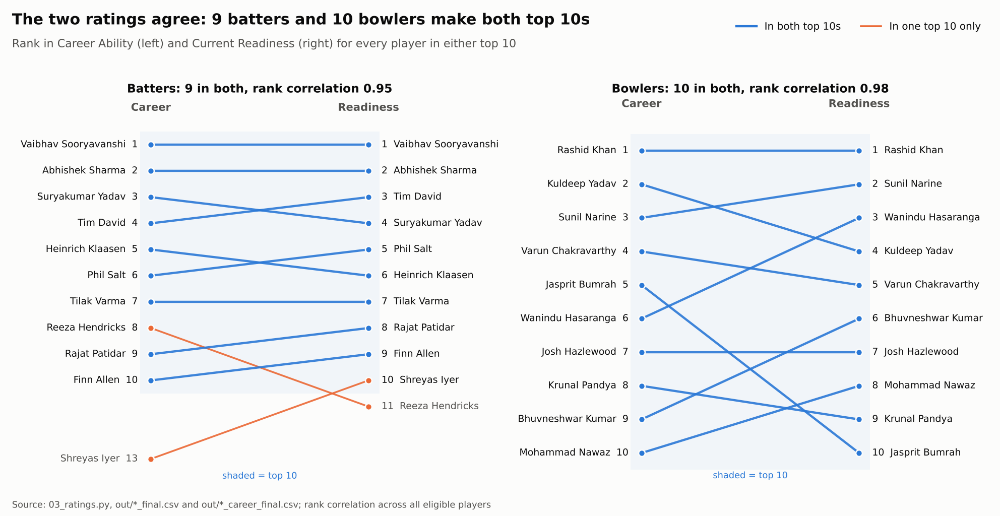
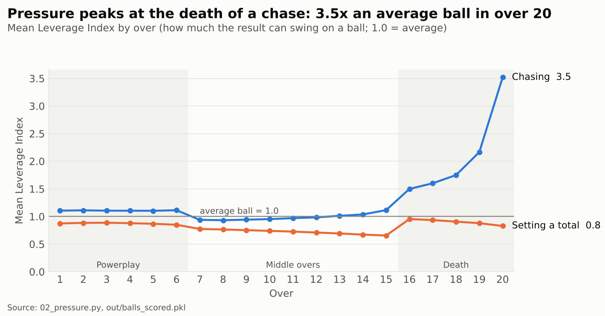
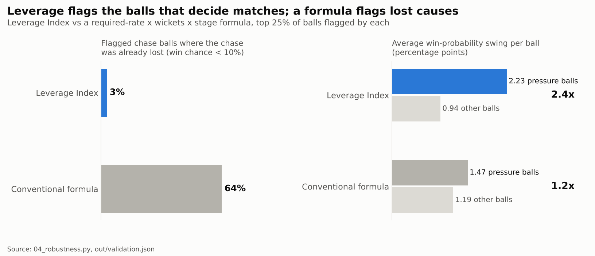
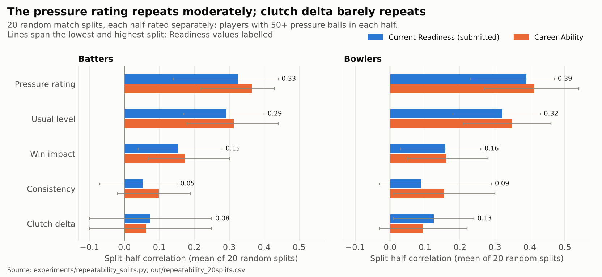
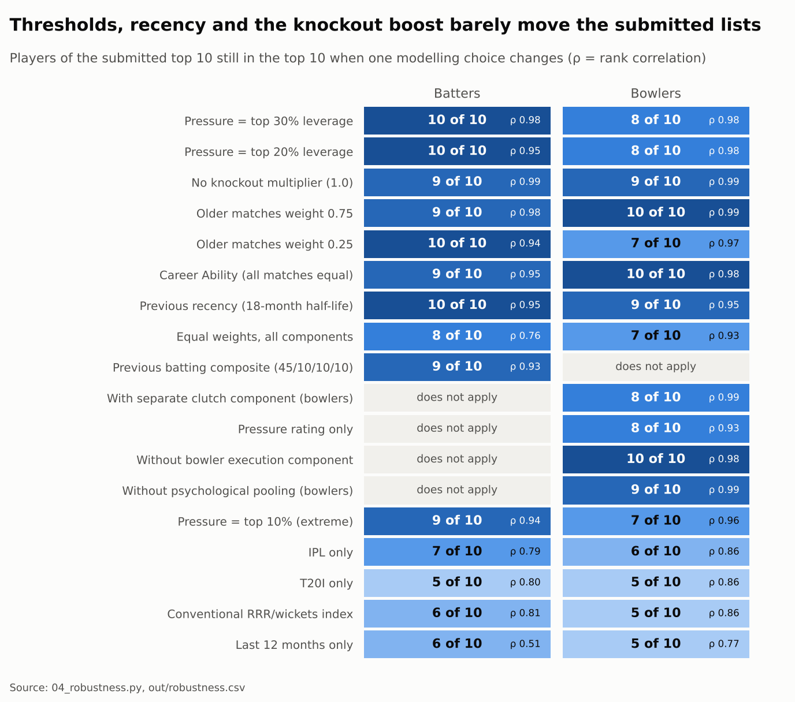
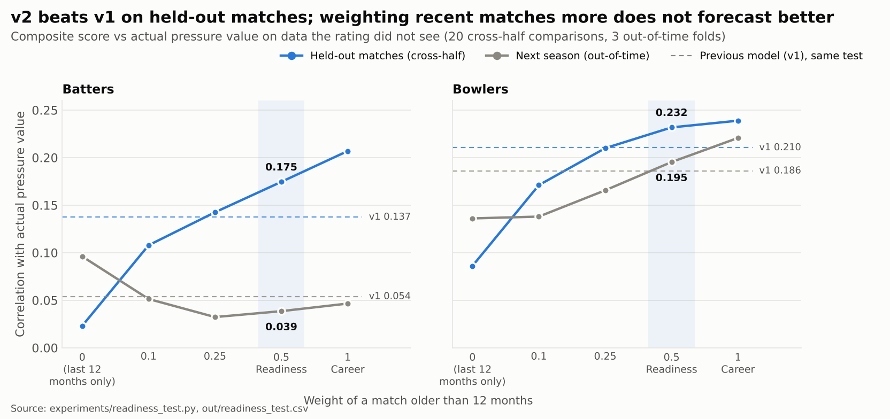
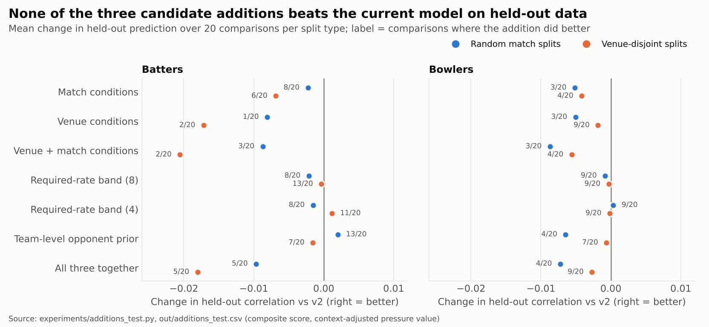

# SupeRR Selector Season 2 — Who Delivers Under Pressure?

A data-driven system that rates IPL and T20I batters and bowlers in **high-pressure match situations** against how an average player performs in the same situation. It produces two separate ratings and a ranked top 10 of each.

Built for Round 1 of Rajasthan Royals' *SupeRR Selector Season 2* using only the supplied data pack: 883 matches from January 2022 to 1 November 2026 and 201k deliveries. The analysis was rerun on the updated ball-by-ball dataset published during Round 1: the file at the update link is byte-for-byte identical to the one used here (MD5 `c5bbd29fe98b35a46d83c7dc7072a27d`).

**What this report shows, and what it does not.** This report ranks the batters and bowlers who perform best when the match is on the line. I define pressure from a win-probability model: a ball is a pressure ball when the result can swing most on it. I also tested two stricter definitions (section 4.5). They pick out cleaner pressure moments, and players visibly change how they play in them, but they leave too few moments per player to rank reliably. So my lists rank performance in high-stakes moments. They lean on each player's usual level, and they do not claim to show who lifts his game under pressure. I mark the players who hold their place under all three definitions as my firmest picks.

---

## Final rankings

Two ratings answer two different questions. They are never combined into one score (section 5.6).

- **Current Pressure Readiness (submitted):** who is performing best under pressure now? Matches from the last 12 months count fully. Older matches count half, so they act as the starting point that recent form updates.
- **Career Pressure Ability:** who has shown the most ability under pressure across 2022–2026? Every match counts equally.

| Rank | Batter: Readiness (submitted) | Bowler: Readiness (submitted) | Batter: Career | Bowler: Career |
|---:|---|---|---|---|
| 1 | Vaibhav Sooryavanshi | Rashid Khan | Vaibhav Sooryavanshi | Rashid Khan |
| 2 | Abhishek Sharma | Sunil Narine | Abhishek Sharma | Kuldeep Yadav |
| 3 | Tim David | Wanindu Hasaranga | Suryakumar Yadav | Sunil Narine |
| 4 | Suryakumar Yadav | Kuldeep Yadav | Tim David | Varun Chakravarthy |
| 5 | Phil Salt | Varun Chakravarthy | Heinrich Klaasen | Jasprit Bumrah |
| 6 | Heinrich Klaasen | Bhuvneshwar Kumar | Phil Salt | Wanindu Hasaranga |
| 7 | Tilak Varma | Josh Hazlewood | Tilak Varma | Josh Hazlewood |
| 8 | Rajat Patidar | Mohammad Nawaz | Reeza Hendricks | Krunal Pandya |
| 9 | Finn Allen | Krunal Pandya | Rajat Patidar | Bhuvneshwar Kumar |
| 10 | Shreyas Iyer | Jasprit Bumrah | Finn Allen | Mohammad Nawaz |

**Players in both top 10s** (established *and* current), the strongest picks:
- **Batters (9):** Vaibhav Sooryavanshi, Abhishek Sharma, Tim David, Suryakumar Yadav, Phil Salt, Heinrich Klaasen, Tilak Varma, Rajat Patidar, Finn Allen.
- **Bowlers (10):** Rashid Khan, Sunil Narine, Wanindu Hasaranga, Kuldeep Yadav, Varun Chakravarthy, Bhuvneshwar Kumar, Josh Hazlewood, Mohammad Nawaz, Krunal Pandya, Jasprit Bumrah.

**The submitted lists are the pure performance ranking** (the `rank` column). No player is left out for nationality or availability, because Round 1 asks who performs best under pressure, not who a franchise could pick (section 7).

**How firmly each pick holds.** The submitted order uses my Stakes definition. The marker says how many of the three pressure definitions tested in section 4.5 also put the player in the top 10: **Firm** = all three (4 batters, 6 bowlers), **Fairly firm** = two, **Depends on the definition** = Stakes only. The Cost of failure and Strict columns are each player's rank under those definitions. Clutch Δ is how much better (runs per 100 pressure balls) the player does under pressure than his usual level predicts; it repeats only weakly (section 8.1), so it is shown, not ranked on.

| Rank | Batter | Cost of failure | Strict | Marker | Clutch Δ | Bowler | Cost of failure | Strict | Marker | Clutch Δ |
|---:|---|---:|---:|---|---:|---|---:|---:|---|---:|
| 1 | Vaibhav Sooryavanshi | 2 | Not eligible | Fairly firm | +10.3 | Rashid Khan | 2 | 1 | Firm | +12.0 |
| 2 | Abhishek Sharma | 1 | Not eligible | Fairly firm | +6.2 | Sunil Narine | 1 | 2 | Firm | +6.0 |
| 3 | Tim David | 4 | 2 | Firm | +15.0 | Wanindu Hasaranga | 3 | 10 | Firm | +2.8 |
| 4 | Suryakumar Yadav | 3 | 1 | Firm | +8.0 | Kuldeep Yadav | 5 | 5 | Firm | +9.9 |
| 5 | Phil Salt | 6 | Not eligible | Fairly firm | +7.4 | Varun Chakravarthy | 8 | 11 | Fairly firm | +4.0 |
| 6 | Heinrich Klaasen | 9 | 3 | Firm | +6.7 | Bhuvneshwar Kumar | 60 | 9 | Fairly firm | +0.4 |
| 7 | Tilak Varma | 14 | 4 | Fairly firm | +12.9 | Josh Hazlewood | 4 | 8 | Firm | +12.2 |
| 8 | Rajat Patidar | 12 | Not eligible | Depends on the definition | +8.1 | Mohammad Nawaz | 7 | 3 | Firm | +3.1 |
| 9 | Finn Allen | 17 | Not eligible | Depends on the definition | +0.9 | Krunal Pandya | 6 | 12 | Fairly firm | +4.1 |
| 10 | Shreyas Iyer | 7 | 7 | Firm | +9.8 | Jasprit Bumrah | 15 | 15 | Depends on the definition | +1.9 |

- **Openers.** Sooryavanshi, Abhishek Sharma, Salt and Allen cannot qualify under Strict, because they bat when plenty of batting is still to come. Most of their pressure balls are in the powerplay (74–100%), so read their rating as "best in high-stakes early overs".
- **Bhuvneshwar Kumar** bowls the powerplay and the death. Under Cost of failure, pressure moved to the middle overs and he fell to 60th; under Strict he is back in the top 10 (9th).
- **Jasprit Bumrah** is 15th under both other definitions. His pressure rating beats the bowlers ranked 7th and 9th, but lower win impact and consistency put his combined score 10th.

Full rankings for all 107 eligible batters and 107 eligible bowlers are in `results/bat_final.csv` and `results/bowl_final.csv` (Readiness) and `results/bat_career_final.csv` and `results/bowl_career_final.csv` (Career).




All figures are produced by `06_figures.py` (section 11) and live in `figures/`.

---

## The idea in one paragraph

Pressure is not defined by a hand-picked rule such as "required rate above 10". The system builds a **win-probability model** from the ball-by-ball data, including each team's pre-match strength. It scores every delivery with a **Leverage Index**: how much the match result can swing on that ball. The top 25% of balls by leverage in each innings are *pressure balls*. Every player is rated on the value he produces on those balls, compared with the average player in the identical situation and adjusted for the quality of the opposition (and, for batters, the type of bowling faced). Bowlers are also rated on **execution under pressure**: whether they bowl more wides, no-balls and full tosses than expected when it matters. For bowlers, deliveries bowled under **psychological pressure** (just hit for a boundary, coming off an expensive over, poor recent form, after a teammate's expensive over) also count, at quarter weight, when the match is moderately tense. The rating is estimated hierarchically so that small samples cannot dominate. It is computed twice: once with every match counted equally (**Career Ability**) and once with the last 12 months counted fully and older matches counted half (**Current Readiness**). Each ball is used once in each rating.

---

## Contents

1. [Pipeline overview](#1-pipeline-overview)
2. [Data cleaning](#2-data-cleaning)
3. [Win-probability model](#3-win-probability-model)
4. [Defining pressure: the Leverage Index](#4-defining-pressure-the-leverage-index)
5. [Measuring performance](#5-measuring-performance)
6. [Rating and scoring](#6-rating-and-scoring)
7. [Eligibility and fair comparison](#7-eligibility-and-fair-comparison)
8. [Validation and reliability](#8-validation-and-reliability)
9. [Model improvements tested](#9-model-improvements-tested)
10. [Limitations](#10-limitations)
11. [How to run](#11-how-to-run)
12. [Output files](#12-output-files)
13. [Repository structure](#13-repository-structure)

---

## 1. Pipeline overview

```
Data Pack CSVs
   │
   ▼
01_state.py        clean data, exclusions, match state before every ball
   │
   ▼
02_pressure.py     pre-match Elo → Markov win-probability + expected-runs model
                   → Leverage Index, pressure flags, run value, win-probability added
                   → psychological pressure situations for bowlers
   │
   ▼
03_ratings.py      bowler psychological pooling → context residuals → batter matchup adjustment → opposition adjustment
                   → hierarchical ratings → bowler execution component → composite score
                   → done twice: Current Readiness and Career Ability
                   → split-half reliability, 300-sample bootstrap (both ratings)
   │
   ▼
04_robustness.py   sensitivity of the submitted lists to 18 alternative modelling choices,
                   pressure validation
   │
   ▼
05_final_tables.py final ranked tables for both ratings (last team, last match, national team)
   │
   ▼
06_figures.py      the README figures (figures/*.png)
```

---

## 2. Data cleaning

| Step | Detail |
|---|---|
| Matches in data pack | 883 |
| Removed: no result or abandoned | 41 (no winner, so no win probability to model) |
| Removed: rain-affected (revised overs or target) | 24 (DLS states do not fit a 120-ball model) |
| Removed: Emerging Teams Asia Cup 2024, Asia Cup Rising Stars 2025 | 30 (tagged `T20` but neither IPL nor full T20I) |
| Removed: super overs (innings 3–4) | 38 balls |
| **Kept** | **788 matches (357 IPL, 431 T20I), 188,151 deliveries** |

How deliveries are interpreted:

- **Illegal deliveries.** `extras_type` values `wide`, `Overstep` and `other` are not legal balls (`Overstep` and `other` are no-balls). With them removed, every complete over has exactly six legal balls.
- **Runs.** `runs` holds runs off the bat only. Extras are in `extras1_runs` and `extras_2_runs`, and an innings total is all three added together.
- **Balls faced.** A batter faces every ball except a wide.
- **Runs charged to the bowler.** Bat runs plus wide and no-ball penalty runs. Byes and leg-byes are not charged.
- **Bowler wickets.** Caught, bowled, LBW, stumped and hit wicket. Run-outs are not credited to the bowler.
- **Retired out** (6 balls) reduces the batting side's wickets in hand, as in the Laws, but is neither credited to the bowler nor charged to the batter as a dismissal.
- **A wicket off a wide** (39 balls) is coded as a wicket in the win model's outcome tables: losing the wicket matters far more than the extra run.

---

## 3. Win-probability model

**File:** `02_pressure.py`

### 3.1 Model

The model has two layers.

**Layer 1 — ball-by-ball Markov model, solved by dynamic programming.**

- **States.**
  - Chasing: (balls remaining, wickets in hand, runs needed).
  - Batting first: (balls remaining, wickets in hand, runs scored).
- **Ball outcomes.** Dot, 1, 2, 3, 4, 6, wicket, wide, no-ball.
- **Outcome probabilities** are estimated from the data per:
  - **scoring environment:** IPL 2022–23, IPL 2024–26 (the Impact Player era, when scores jumped) and T20I;
  - **phase:** powerplay, middle overs or death overs;
  - **wickets in hand:** 0–10;
  - **required run rate** (8 bands), in the chase only, so batters swing harder when they need to.
- **Smoothing.** Sparse cells are smoothed towards coarser cells (wickets-in-hand band, then environment × phase) with pseudo-counts of 40 and 30.
- **Chase.** The table `V2[env, balls, wickets, need]` is solved backwards from the last ball. A wide or no-ball re-bowls the same ball. A tie counts as 0.5 (super over), whether the scores are level after the last ball or the chasing side is all out with the scores level.
- **First innings.** The model computes the full distribution of remaining runs from every state, then combines it with the chase table: P(win | final total T) = 1 − P(chaser wins | needs T + 1).

**Layer 2 — calibration with team strength.** One logistic regression per innings, on two inputs:

```
P(win) = sigmoid( a + b · logit(Markov probability) + c · Elo difference / 100 )
```

- **Elo difference** is the batting side's pre-match Elo minus the fielding side's. Elo starts at 1500 with K = 24, and each team is updated only *after* its match, so there is no look-ahead.
- **Fitted coefficients:**
  - 1st innings: b = 0.64, c = 0.38, a = −0.10.
  - 2nd innings: b = 0.76, c = 0.19, a = 0.41.

**Why a Markov model rather than a gradient-boosted classifier?** An earlier tree-model version (`HistGradientBoostingClassifier` with monotonic constraints) was badly wrong on rare end-of-match states: it gave 93% for "need 4 off the last ball". The dynamic-programming layer is exact at the final ball *given its outcome probabilities*, monotone by construction, and fits better.

**The published win probabilities are calibrated, so they are not exact at the final ball.** Layer 2 moves them: "need 4 off the last ball" is 26% raw and 39% calibrated (section 3.5). The calibration is kept at the end of chases because it is *more* accurate there than the raw layer (section 3.3).

### 3.2 Fit

| Innings | Log-loss | Brier score | AUC |
|---|---:|---:|---:|
| 1st innings (setting a total) | 0.617 | 0.214 | 0.715 |
| 2nd innings (chasing) | 0.393 | 0.128 | 0.901 |

- **Brier score** is the mean squared error of the probability (lower is better). A coin flip scores 0.25.
- **AUC** is the chance that a random winning state is rated above a random losing one (0.5 is chance, 1.0 is perfect).
- **First innings** is inherently harder to predict, because half the match is still to come.

Every version that was tried. The Markov rows are scored in-sample; the gradient-boosting row is scored out-of-fold (5-fold grouped cross-validation), so it is not a like-for-like comparison and in-sample it would look somewhat better:

| Model version | 1st inns log-loss | 1st inns Brier | 1st inns AUC | 2nd inns log-loss | 2nd inns Brier | 2nd inns AUC |
|---|---:|---:|---:|---:|---:|---:|
| Gradient boosting (scored out-of-fold, 5-fold grouped CV) | 0.641 | 0.223 | 0.690 | 0.407 | 0.132 | 0.894 |
| Markov, wickets in 3 bands | 0.627 | 0.219 | 0.701 | 0.399 | 0.130 | 0.897 |
| Markov, every wicket | 0.626 | 0.219 | 0.702 | 0.394 | 0.128 | 0.900 |
| **Markov, every wicket + Elo (final)** | **0.617** | **0.214** | **0.715** | **0.393** | **0.128** | **0.901** |

The Elo gain also holds when the calibration layer is refitted on held-out folds and on 2026 matches (section 9.1). In those tests only the calibration layer is refitted; the Markov outcome tables are fitted on all matches, so they are not fully held-out tests of the whole model. The outcome tables are cell-level frequencies smoothed with pseudo-counts, which limits how much they can overfit.

### 3.3 Calibration

Predicted and actual win rates (all balls, both innings) agree within about 3 percentage points in every 10% band:

| Predicted band | Mean predicted | Actual win rate | Balls |
|---|---:|---:|---:|
| 0–10% | 0.031 | 0.032 | 21,061 |
| 10–20% | 0.151 | 0.171 | 12,493 |
| 20–30% | 0.253 | 0.222 | 14,768 |
| 30–40% | 0.352 | 0.323 | 19,291 |
| 40–50% | 0.453 | 0.455 | 27,169 |
| 50–60% | 0.548 | 0.570 | 29,025 |
| 60–70% | 0.647 | 0.662 | 20,201 |
| 70–80% | 0.747 | 0.748 | 14,704 |
| 80–90% | 0.849 | 0.835 | 11,639 |
| 90–100% | 0.965 | 0.961 | 17,800 |

Split by innings, every band still agrees within 4 points:


**The end of chases.** The calibration has its largest effect on the last balls of a chase, which are also the highest-leverage balls. Checked on the last 12 balls of every chase (5,436 balls, 548 matches), it improves on the raw Markov layer: Brier 0.0654 vs 0.0688, log-loss 0.214 vs 0.228. The raw layer underrates chasing sides in close finishes:

| Raw Markov band | Mean raw | Mean calibrated | Actual win rate | Balls |
|---|---:|---:|---:|---:|
| 0–10% | 0.010 | 0.028 | 0.027 | 3,207 |
| 10–30% | 0.189 | 0.323 | 0.298 | 494 |
| 30–50% | 0.403 | 0.525 | 0.528 | 301 |
| 50–70% | 0.606 | 0.677 | 0.763 | 342 |
| 70–90% | 0.806 | 0.815 | 0.931 | 375 |
| 90–100% | 0.976 | 0.966 | 0.990 | 717 |

So the calibration is applied at every ball, including the last ones. Both layers still underrate chasing sides that are ahead late on (the 50–90% raw bands), but the calibrated value is the closer of the two in every band except the top one.

### 3.4 Why Platt scaling and not isotonic regression?

The common rule of thumb says to use isotonic calibration once you have more than about 1,000 samples. It doesn't apply here, for two reasons.

1. **The independent sample size is 788, not 188,000.** Every ball in a match shares the same outcome label (who won), so the number of independent outcomes is the number of matches. With that few, isotonic regression overfits its step function. In 5-fold cross-validation grouped by match, it halved the calibration error, but it made log-loss and AUC worse and Brier no better (table in section 9).
2. **The Leverage Index needs a smooth curve.** Leverage is built from *differences* in win probability between neighbouring states. Isotonic output is a staircase: on a flat step a boundary would show zero swing, and at a jump a dot ball could look like a huge one. Platt scaling is smooth and monotone.

### 3.5 Sense checks (real chase states from the data)

| State | Raw Markov | Calibrated (used) | Leverage Index |
|---|---:|---:|---:|
| Need 4 off the last ball, 6 wickets in hand | 26% | 39% | 33.7 |
| Need 1 off the last ball, 3 wickets in hand | 85% | 85% | 14.5 |
| Need 10 off 6, 5 wickets in hand | 58% | 67% | 6.4 |
| Need 180 off 120, 10 wickets in hand | 35% | 47% | 1.4 |

Values are means over the real balls in that state, so they include each match's Elo difference.

---

## 4. Defining pressure: the Leverage Index

### 4.1 Formula

For each delivery:

```
            Σ_o  p(o | state) · | WP(state after o) − WP(state) |
LI(ball) = ─────────────────────────────────────────────────────
                       mean of the numerator over all balls
```

- `o` runs over the nine possible outcomes, and `p(o | state)` comes from the same outcome tables as the win-probability model.
- **LI = 1.0** is an average ball. **LI = 5** means the match result is five times as sensitive as usual.
- **Knockout matches** get a 1.2× stakes multiplier. This is a deliberate, mild assumption: an elimination game carries more at stake in the same match situation. It touches 24 matches (3% of balls, 6% of pressure balls). Section 9.7 rejected a full stakes model as a *replacement* (it concentrated pressure in too few games), which is a different and much stronger assumption. Without the multiplier the bowling list is unchanged and 8 of 10 batters stay; Vaibhav Sooryavanshi then falls just below the 120-pressure-ball eligibility floor (section 8.3).
- **Team strength is included,** so a strong side chasing against a minnow is correctly less pressured.

### 4.2 Pressure threshold

A ball is a **pressure ball** if its LI is in the **top 25% for its innings** (thresholds: LI ≥ 0.92 batting first, LI ≥ 1.58 chasing).

The cut is per innings because first-innings balls move the final result less in absolute terms. A collapse while setting a total is still that innings' pressure moment, and players who mostly bat first should not be excluded.

Share of balls flagged as pressure, by phase: death overs 52%, powerplay 26%, middle overs 11%.

### 4.3 What it captures and what it ignores

- **Captures:** death overs of tight chases, powerplay collapses, first-innings death overs.
- **Ignores:** dead rubbers and lost causes. Needing 80 off 24, or defending 230 with the game won, scores near zero however frantic it looks.



### 4.4 Validation: why leverage beats a formula

A conventional index was built for comparison: required-rate ratio × wickets lost × stage of innings in the chase, and early wickets × death overs when batting first.

| Check | Leverage Index | Conventional formula |
|---|---:|---:|
| Flagged chase balls where the chasing side already had under 10% win chance | **3%** | 64% |
| Average absolute win-probability swing per ball, pressure vs other | **2.23 vs 0.94 pts (2.4×)** | 1.47 vs 1.19 pts (1.2×) |

- Share of balls flagged as pressure: 37% in close matches vs 18% in one-sided ones (260 close, 528 one-sided).
- League-wide behaviour on pressure balls vs other balls: strike rate 148 vs 137, dismissal rate 6.3% vs 5.1% of balls, dot rate 36.3% vs 37.2%.



### 4.5 Three definitions of pressure, tested

The cleaner the definition of pressure, the fewer pressure moments each player has, and the less reliably players can be told apart.

Two stricter definitions were built and tested against the submitted one, each with pass rules fixed before it was run. Neither passed, so the Leverage Index stays.

| | Stakes (submitted, v5) | Cost of failure (v6) | Strict: cost of failure with little left (v7) |
|---|---|---|---|
| What counts as pressure | The result can swing most on this ball, in either direction. Top quarter of balls in each innings | Failing now would cost a lot of win chance (out or a dot for a batter, a four or no-ball for a bowler). Whole innings or whole over | Failing is costly, the result is still open (win chance 10–90%), and little is left to recover with (two or fewer proper batters to come, or the last five overs) |
| Share of batter balls rated as pressure | 25% | 50% | 14% |
| Low-risk "free swings" among those balls | 40.6% | 32.8% | 8.3% |
| Batter balls from games already decided | 2.2% | 10.5% | 0.0% |
| How much players change behaviour, batters / bowlers (percentage points) | 2.7 / 2.9 | 4.3 / 1.9 | 6.9 / 3.3 |
| Does a player's lift under pressure repeat? Batters / bowlers (0 is luck, 1 is perfect) | 0.08 / 0.13 | 0.19 / 0.21 | 0.07 / 0.08 |
| Players with enough pressure moments to rank, batters / bowlers | 107 / 107 | 128 / 93 | 41 / 92 |
| How often the top 10 stays the top 10 when matches are resampled, batters / bowlers | 71% / 62% | 66% / 69% | 69% / 62% |
| Outcome | **Submitted** | Not adopted. It counts balls from decided games, and 80% of its batter pressure balls come from chases, which partly explains its higher lift: on chase balls alone it falls to 0.14 / 0.14 | Not adopted. Only 41 batters can be ranked, and 5 of the submitted top 10 batters cannot be ranked at all |

- The strictest definition finds the most convincing pressure moments: no decided games, almost no free swings, and the largest change in how players behave.
- It cannot be used for ranking: only 41 batters have enough such moments, and a player's lift in them repeats no better than under the submitted definition.
- **Cost of failure's higher lift is partly chasing.** Re-running the lift test on chase balls only (innings 2, pressure and normal balls) lowers it from 0.19 / 0.21 to 0.14 / 0.14 (batters / bowlers, 50+ pressure balls in each half, same 20 splits). For bowlers that matches Stakes (0.13); for batters it stays above Stakes (0.08), so chasing explains part of the gap, not all of it. Only 52 bowlers qualify on chase balls, and the figure ranges from -0.05 to 0.40 across the splits. Script and output: `results/definition_comparison/chase_lift_check.py` and `chase_lift_check.csv`.

How the rows are measured: free swings are powerplay balls with 9+ wickets in hand or first-innings death balls with 6+; behaviour change is flagged minus other balls for the same player in the same innings and phase, summed over dismissal, dot and boundary rates (batters) or error, dot, boundary and wicket rates (bowlers); "lift" is clutch Δ, correlated between two random halves of the matches over 20 splits for players with 50+ pressure balls in each half (only 50 batters qualify under Strict). The full Cost of failure (v6) and Strict (v7) results files and the regenerated numbers are in `results/definition_comparison/`.

**Pressure changes how players play.** In the moments the strictest definition calls pressure, batters protect their wicket: they are dismissed 3.25 percentage points less often than on their other balls in the same phase of the same innings (95% range -3.71 to -3.06 over 500 resamples of whole matches), and play 2.75 points fewer dot balls (-3.61 to -1.82). Bowlers bowl slightly more wides, no-balls and full tosses: 0.62 points more, with a range (0.03 to 1.01) that only just excludes zero.

---

## 5. Measuring performance

### 5.1 Ball value (runs currency)

The Markov model gives `ER(balls, wickets)`, the expected runs still to come from any state.

```
Batter value  = bat runs + ER(state after) − ER(state before)
Bowler value  = −[ runs charged + ER(state after, own wickets only) − ER(state before) ]
```

- A dot ball costs a little.
- A wicket in the 5th over costs 9–23 runs, more if wickets have already fallen.
- A wicket in the 19th over costs 0.5–2.5 runs.

### 5.2 Win Probability Added (WPA)

WPA is the change in win probability that is attributable to the batter (bat runs and his own dismissal) or to the bowler (runs charged and his own wickets).

### 5.3 Context residual

From every ball's value, the system subtracts the average value of all balls in the same cell:

```
scoring environment × innings × phase × wickets-in-hand band × pressure (yes/no)
```

A death-overs finisher is therefore judged against other death-overs finishers, and an opener against other openers.

### 5.4 Matchup adjustment (batters only)

Batters' residuals are further adjusted for the type of bowling faced: pace or spin × bowling arm × batter's hand (8 matchups), within each phase. The adjustment is additive, so no cell gets too thin.

Bowlers are deliberately **not** adjusted this way:

- A bowler's type is part of his own skill.
- Captains only trust their best spinners at the death.
- So comparing Rashid Khan with "spinners under pressure" compares him with an elite-only peer group and penalises the very skill being measured.
- In testing, applying it to bowlers pushed Rashid from 1st to 5th and Narine from 2nd to 4th.

### 5.5 Opposition adjustment

Batter and bowler effects are estimated together over all balls, by alternating shrunk weighted averages (3 passes):

- the batter's residual is adjusted for the bowler he faced;
- the bowler's residual is adjusted for the batter he bowled to.

This discounts runs scored against weak attacks (associate nations, part-timers) and wickets taken against weak batting.

### 5.6 Two ratings: how matches are weighted

The whole rating (sections 5.3–6.5) is computed twice, with different ball weights:

| Rating | Question | Ball weight |
|---|---|---|
| **Current Pressure Readiness** (submitted) | Who is performing best under pressure now? | **1** for balls in the last 12 months (since 1 Nov 2025); **0.5** for older balls |
| **Career Pressure Ability** | Who has shown the most ability under pressure across 2022–2026? | **1** for every ball |

**How Readiness works.** Older matches act as the starting point and the last 12 months update it. How far a player moves depends on how much recent evidence he has, because the hierarchical estimate (section 6.1) trusts a player's own record in proportion to his effective number of balls. A batter with 200 recent pressure balls moves most of the way to his recent level. One with 20 stays close to his older level, so a lucky or unlucky month cannot make or break him. A player with no older matches starts from the league prior and is rated on his recent balls.

**Each ball is counted once.** Recent form enters Readiness only through these weights. There is no separate form component (the previous version added a 25% "last 12 months" component *on top of* an 18-month recency weighting, so recent matches counted twice). The two ratings are never added together: that would count recent matches twice again.

**Why 0.5 for older balls.** It was chosen by testing 0, 0.1, 0.25, 0.5 and 1 on held-out data (section 9.2). 0.5 predicts held-out pressure performance as well as the alternatives on future seasons, and better than lower weights on held-out matches.

---

## 6. Rating and scoring

### 6.1 Hierarchical pressure rating

Raw averages on pressure balls are noisy at typical sample sizes (split-half r = 0.23 for batters). So the true pressure value `μ` is estimated from both the player's pressure record and his usual level:

```
μ̂ᵢ = β · Bᵢ + sᵢ · (P̄ᵢ − β · Bᵢ)

sᵢ  = nᵢ / (nᵢ + σ² / τ²)
```

| Symbol | Meaning |
|---|---|
| `Bᵢ` | Player's usual level: shrunk weighted average on non-pressure balls |
| `P̄ᵢ` | Raw weighted average on pressure balls (weights from section 5.6) |
| `nᵢ` | Effective number of pressure balls, Kish's `(Σw)² / Σw²`, where `w` is the ball's combined weight (rating weight × bootstrap frequency × the quarter weight of a pooled bowler ball, section 6.5). With equal weights it is the ball count |
| `σ²` | Ball-to-ball noise variance |
| `β` | How much usual level carries over to pressure |
| `τ` | Spread of true pressure-specific ability between players, in runs per 100 balls |

Fitted values:

| | Readiness: batters | Readiness: bowlers | Career: batters | Career: bowlers |
|---|---:|---:|---:|---:|
| `β` | 1.03 | 0.74 | 1.14 | 0.77 |
| `τ` | 12.7 | 8.7 | 12.2 | 8.1 |

- `β` and `τ²` are estimated from the data by weighted least squares and method of moments (empirical Bayes), separately for each rating. The shrinkage itself is not hand-tuned.
- A player with few pressure balls is rated mostly on his usual level. One with many is rated mostly on his own pressure record.
- `sᵢ · (P̄ᵢ − β·Bᵢ)` is the player's **clutch Δ**: how much better or worse he is under pressure than his usual level predicts.
- **The lists rank the level a player reaches under pressure, not how far he rises above his usual level.** Clutch Δ is shown beside each rank (Final rankings) but repeats only weakly between halves of the matches (section 8.1).

### 6.2 Components

All values are in runs per 100 balls above an average player in the same situation, unless noted.

| Component | Definition |
|---|---|
| **Pressure rating** | `μ̂` above, ×100 |
| **Clutch Δ** | Shrunk pressure-specific deviation, ×100 |
| **Consistency** | Share of matches (with ≥ 3 pressure balls) whose pressure value is positive, weighted by the rating's ball weights and smoothed towards the league rate with 6 pseudo-matches |
| **Win impact** | Shrunk WPA above the context average on pressure balls, in win-probability percentage points per 10 balls |
| **Execution** (bowlers only) | How well a bowler avoids execution errors under pressure (section 6.4) |

For bowlers, every component is computed on the pressure balls *plus* the pooled psychological-pressure balls at quarter weight (section 6.5).

### 6.3 Composite score

Each component is z-scored among eligible players, then combined. The weights are the same in both ratings:

| Component | Batters | Bowlers |
|---|---:|---:|
| Pressure rating | **100%** | 52.6% |
| Consistency | reported only | 13.1% |
| Win impact | reported only | 19.7% |
| Execution | — | 14.6% |
| Clutch Δ | inside the pressure rating | inside the pressure rating |

How these were set:

- **No separate clutch Δ component.** Clutch Δ is already part of the pressure rating (`β · usual level + shrunk clutch Δ`, section 6.1), at the weight its evidence supports. Adding it again as its own component counted it twice: about 1.4 times its intended weight for batters and 1.6 times for bowlers.
- **Batters are ranked on the pressure rating alone.** Consistency and win impact did not improve held-out prediction for batters (section 9.13), so under the section 9 rule they are reported in the tables, not scored.
- **Bowlers keep consistency, win impact and execution,** because each improves held-out prediction for bowlers (section 9.13). Their relative weights are the earlier ones (36 / 9 / 13.5 / 10), rescaled to sum to 100%.
- **No separate 12-month form component** (section 9.2).

The bowling weights are a judgement call, but the list barely depends on them (section 8.3).

```
score = Σ weight_k · z_k
```

Players are ranked by `score`.

### 6.4 Execution under pressure (bowlers)

- **Execution error:** a wide, a no-ball, a full toss or a beamer. An error ball costs 79 runs per 100 balls more than other balls (t = −27).
- **Errors depend mostly on the phase, not on pressure.** On normal balls the league error rate is about 6% in the powerplay and middle overs but 16.6% at the death. *Within* the death, pressure barely changes it (16.5%). Pressure balls are concentrated at the death, so any comparison that ignores the phase measures how many death overs a bowler bowls, not how well he executes.
- **Expected errors, phase by phase.** For each phase, a bowler's expected error rate on pressure balls = his own normal-ball error rate *in that phase* (shrunk towards the league's normal rate for that phase with 20 pseudo-balls) × the league-wide pressure/normal ratio within that phase. These are summed over his pressure balls in each phase.
- **Score: shrunk excess error rate** = (actual errors − expected errors) / (pressure balls + 20). The shrinkage pulls small samples towards zero, so the score does not grow with workload. Its correlation with a bowler's number of pressure balls is −0.09 (−0.03 before the psychological pooling of section 6.5).
- **Execution** = minus the standardised shrunk excess, so higher means better execution.
- It needs at least 30 pressure and 100 other balls. Every eligible bowler qualifies.
- It is computed separately for each rating with that rating's ball weights, once on the full data, and held fixed in the bootstrap.
- It uses the same pooled pressure set as the rating (section 6.5).

**What changed from the previous version** (section 9.13). The previous score compared each bowler's pressure balls with his *all-phase* normal rate (so the death-overs jump counted against him), used z-scores against a sampling null (which grow with sample size whenever the expectation is slightly off), and added a direction-blind delivery-mix term (more yorkers than expected was penalised like more full tosses). Its correlation with workload was −0.56, and the 12 worst scores were all high-volume pacers. The rebuilt score predicts held-out pressure value as well as the old one, without the workload bias.

**Caveat:** full tosses are not always errors. Some bowlers (Bumrah, for example) bowl them deliberately at the death and concede little from them. The comparison with each bowler's own death-overs rate absorbs most of this, but not all.

### 6.5 Psychological pressure situations (bowlers)

Leverage measures how much the *match* is at stake on a ball. A bowler can also be under pressure that the match situation does not show: he has just been hit for six, or he is coming off an expensive over. Section 9.14 tested ways of using such situations; one improved held-out prediction for bowlers and is used.

**A delivery is psychologically pressured for the bowler** (`psy_bowl`, set in `02_pressure.py`) if any of these holds:

| Situation | Definition | Share of deliveries |
|---|---|---:|
| Just hit | The previous ball of the same over went for 4 or 6 | 15% |
| After his own bad over | His previous over in the innings cost 12 or more | 14% |
| Poor recent form | His economy over his previous 3 matches is above 10 | 20% |
| After a teammate's bad over | The previous over, bowled by a teammate, cost 14 or more | 15% |

**How it is used (pooling).** A delivery that is *not* a pressure ball, but has above-median leverage *and* a psychological situation, is added to the bowler's pressure balls at **quarter weight** (`PSY_POOL_WEIGHT` in `03_ratings.py`). That is 11.3% of bowler deliveries, against 25% that are full pressure balls; the median eligible bowler gains 101 pooled balls next to his 234 pressure balls, worth about 25 extra full balls.
- **Everything in the bowling score uses the pooled set:** the pressure rating, win impact, consistency and execution.
- **Nothing else changes:** eligibility (120 pressure balls), the ball counts in the tables, the normal-vs-pressure statistics and every held-out *target* use real pressure balls only.
- **Batters are not pooled.** No psychological variant improved batting predictions (section 9.14).

**Why quarter weight.** It was the variant that passed the decision rule set before the test (section 9.14). Half weight scored slightly higher afterwards, but choosing it after seeing the results would be picking the winner.

---

## 7. Eligibility and fair comparison

A player is ranked only if he has:

- **≥ 120 pressure balls** faced (batters) or bowled (bowlers);
- **≥ 10 matches** with at least one pressure ball;
- **at least one appearance in the last 12 months** of the data (since 1 Nov 2025), so the lists describe players who are performing now.

That gives 107 eligible batters and 107 eligible bowlers. Eligibility uses unweighted ball and match counts, so **both ratings rank exactly the same pool of players**.

**No availability filter.** Round 1 asks who performs best under pressure, not who a franchise could pick, so the submitted top 10s are the performance ranking itself: no player is left out for nationality, IPL availability or retention. `national_team` in the final tables is for reference only. A player with no recent pressure balls (for example Reeza Hendricks) is still rated in Readiness, mainly from his older matches at half weight.

How the IPL and T20I data are combined:

- Separate scoring environments are used in both the win model and the run model.
- Context residuals are computed within each environment.
- Team strength (Elo) is in the win model, and the opposition adjustment discounts weaker associate-nation opposition.
- IPL-only and T20I-only reruns are part of the robustness checks (section 8.3).

---

## 8. Validation and reliability

### 8.1 Split-half reliability

The matches were split at random into two halves 20 times. Each time, each half was rated independently, and the two halves were correlated for players with at least 50 pressure balls in each half (median 115 batters and 115 bowlers). The table gives the average correlation over the 20 splits, with the lowest and highest split in brackets. Earlier versions of this table used one odd/even split of `match_id`, which turned out to flatter bowler clutch Δ (0.29 on that split, higher than all 20 random splits).

| Component | Readiness: batters | Readiness: bowlers | Career: batters | Career: bowlers |
|---|---:|---:|---:|---:|
| **Pressure rating (hierarchical)** | 0.33 (0.14 to 0.44) | 0.39 (0.23 to 0.47) | 0.37 (0.22 to 0.43) | 0.41 (0.27 to 0.54) |
| Usual level | 0.29 (0.17 to 0.40) | 0.32 (0.18 to 0.43) | 0.31 (0.18 to 0.44) | 0.35 (0.21 to 0.46) |
| Win impact | 0.15 (0.04 to 0.28) | 0.16 (0.03 to 0.26) | 0.17 (0.07 to 0.30) | 0.16 (0.05 to 0.28) |
| Consistency | 0.05 (-0.07 to 0.15) | 0.09 (-0.03 to 0.29) | 0.10 (-0.02 to 0.19) | 0.16 (0.01 to 0.30) |
| Clutch Δ | 0.08 (-0.10 to 0.25) | 0.13 (0.01 to 0.24) | 0.06 (-0.10 to 0.25) | 0.09 (-0.03 to 0.22) |

- **The pressure rating repeats moderately** (0.33 for batters, 0.39 for bowlers in Readiness). Career repeats slightly better, because it uses every match at full weight.
- **Clutch Δ barely repeats:** 0.08 for batters and 0.13 for bowlers. A player's lift or drop under pressure is mostly noise at these sample sizes, so the lists rank the level reached under pressure, which leans on each player's usual level (section 6.1).
- **Batters' consistency is close to noise** (0.05). Batters are therefore ranked on the pressure rating alone (section 6.3); clutch Δ enters only inside it, at its shrunk weight. For bowlers, every component repeats to some degree.
- **Psychological pooling** (section 6.5) was checked on 8 random splits when it was added: the bowler pressure rating's reliability averaged 0.39 with pooling against 0.40 without, and the whole bowling score's rose from 0.375 to 0.383.
- Avoiding dismissal under pressure is a real batting trait (split-half r = 0.34 on one split), more repeatable than run-scoring rate under pressure (r = 0.19). These two figures are from the previous version.
- Reproduce with `python experiments/repeatability_splits.py out` (about 5 minutes; writes `out/repeatability_20splits.csv`). `ratings_info.json` still records the single odd/even split for reference.



### 8.2 Bootstrap

Matches were resampled 300 times (Poisson weights, seed 42), with eligibility fixed from the full sample, and the whole rating was recomputed each time. Both ratings use the same resamples.

**Current Pressure Readiness (submitted):**

| # | Batter | In top 10 | Median rank | 80% range | Bowler | In top 10 | Median rank | 80% range |
|---:|---|---:|---:|---|---|---:|---:|---|
| 1 | Vaibhav Sooryavanshi | 92% | 2 | 1–9 | Rashid Khan | 87% | 3 | 1–12 |
| 2 | Abhishek Sharma | 94% | 2 | 1–8 | Sunil Narine | 92% | 3 | 1–10 |
| 3 | Tim David | 92% | 4 | 1–9 | Wanindu Hasaranga | 87% | 5 | 2–13 |
| 4 | Suryakumar Yadav | 97% | 3 | 1–7 | Kuldeep Yadav | 70% | 7 | 2–19 |
| 5 | Phil Salt | 73% | 7 | 3–18 | Varun Chakravarthy | 52% | 10 | 3–27 |
| 6 | Heinrich Klaasen | 66% | 8 | 4–18 | Bhuvneshwar Kumar | 52% | 10 | 3–27 |
| 7 | Tilak Varma | 62% | 8 | 3–19 | Josh Hazlewood | 43% | 12 | 3–31 |
| 8 | Rajat Patidar | 50% | 10 | 4–32 | Mohammad Nawaz | 53% | 10 | 2–37 |
| 9 | Finn Allen | 46% | 12 | 4–55 | Krunal Pandya | 41% | 12.5 | 5–31 |
| 10 | Shreyas Iyer | 40% | 13 | 6–32 | Jasprit Bumrah | 42% | 13 | 3–35 |

**Career Pressure Ability:**

| # | Batter | In top 10 | Median rank | 80% range | Bowler | In top 10 | Median rank | 80% range |
|---:|---|---:|---:|---|---|---:|---:|---|
| 1 | Vaibhav Sooryavanshi | 89% | 2.5 | 1–11 | Rashid Khan | 93% | 3 | 1–9 |
| 2 | Abhishek Sharma | 92% | 3 | 1–9 | Kuldeep Yadav | 84% | 5 | 1–12 |
| 3 | Suryakumar Yadav | 99% | 2 | 1–6 | Sunil Narine | 88% | 4 | 1–12 |
| 4 | Tim David | 91% | 4 | 2–10 | Varun Chakravarthy | 66% | 7 | 2–23 |
| 5 | Heinrich Klaasen | 84% | 6 | 3–12 | Jasprit Bumrah | 69% | 7 | 2–21 |
| 6 | Phil Salt | 83% | 5 | 2–15 | Wanindu Hasaranga | 78% | 6.5 | 2–14 |
| 7 | Tilak Varma | 64% | 8.5 | 4–18 | Josh Hazlewood | 54% | 9 | 3–31 |
| 8 | Reeza Hendricks | 38% | 12 | 6–37 | Krunal Pandya | 43% | 12 | 4–28 |
| 9 | Rajat Patidar | 33% | 15 | 5–40 | Bhuvneshwar Kumar | 44% | 12 | 3–30 |
| 10 | Finn Allen | 37% | 15 | 5–51 | Mohammad Nawaz | 41% | 13 | 3–42 |

- **Near-certain** (top 10 in at least 70% of resamples): Sooryavanshi, Abhishek Sharma, Tim David, Suryakumar Yadav and Phil Salt among batters; Rashid Khan, Sunil Narine, Wanindu Hasaranga and Kuldeep Yadav among bowlers.
- **The rest are close calls,** in the top 10 in 40–66% (batters) and 41–53% (bowlers) of resamples. On average the Readiness top 10 appear in the bootstrap top 10 71% of the time (batters) and 62% (bowlers).
- **Bootstrap fix.** The v2 and v3 bootstrap counted a duplicated match as fully new evidence, which inflated the estimated spread of pressure skill in every resample (τ about 22 instead of 10 for bowlers) and lowered β. That made the lists look less stable than they are, and especially penalised players whose rating rests on a strong usual level (Bhuvneshwar Kumar was in the top 10 in 12% of resamples; he is 52% now). The effective sample size now uses Kish's formula on the combined weight, which counts a duplicated match as only partly new evidence (section 9.13). The full-data ratings are unaffected.


### 8.3 Sensitivity to modelling choices

Each row reruns the submitted (Readiness) rating with one change. *Overlap* is how many of the submitted top 10 stay in the top 10; *ρ* is the Spearman rank correlation across all eligible players.

| Change | Batters: overlap | Batters: ρ | Bowlers: overlap | Bowlers: ρ |
|---|---:|---:|---:|---:|
| Pressure = top 30% of leverage | 10 | 0.98 | 8 | 0.98 |
| Pressure = top 20% of leverage | 10 | 0.95 | 8 | 0.98 |
| Pressure = top 10% (extreme only) | 9 | 0.94 | 7 | 0.96 |
| Conventional required-rate/wickets index | 6 | 0.81 | 5 | 0.87 |
| No knockout multiplier (1.0), eligibility held fixed | 9 | 0.99 | 9 | 0.99 |
| Career Ability (all matches equal) | 9 | 0.95 | 10 | 0.98 |
| Older matches weight 0.25 | 10 | 0.94 | 7 | 0.97 |
| Older matches weight 0.75 | 9 | 0.98 | 10 | 0.99 |
| Last 12 months only | 6 | 0.51 | 5 | 0.77 |
| Previous recency (18-month half-life, no form component) | 10 | 0.95 | 9 | 0.96 |
| Equal weights over all five components | 8 | 0.76 | 7 | 0.93 |
| Previous batting composite (rating + clutch Δ, consistency, win impact) | 9 | 0.93 | — | — |
| Separate clutch Δ component added back (bowlers) | — | — | 8 | 0.99 |
| Pressure rating only (bowlers) | — | — | 8 | 0.93 |
| Without the bowler execution component | — | — | 10 | 0.98 |
| Without the psychological pooling (bowlers, section 6.5) | — | — | 9 | 0.99 |
| IPL matches only | 7 | 0.79 | 6 | 0.86 |
| T20I matches only | 5 | 0.80 | 5 | 0.86 |

"—" = the change does not apply to that role (batters are already ranked on the pressure rating alone, without clutch Δ, execution or pooling).

- **Thresholds of 20–30%, an older-match weight of 0.75, the knockout multiplier, the 18-month half-life and the clutch, execution and pooling choices barely move the lists** (8–10 of 10 kept, ρ ≥ 0.93).
- **Psychological pooling** (section 6.5) changes one bowler: without it, Mujeeb Ur Rahman is in and Jasprit Bumrah out (ρ 0.99).
- **Older-match weight 0.25** keeps all 10 batters but 7 bowlers. **Equal weights over all five components** keep 8 batters (ρ 0.76, because it brings back the batting components that failed the held-out test) and 7 bowlers.
- **Knockout multiplier.** With eligibility held fixed, removing it keeps 9 of 10 batters and 9 of 10 bowlers. With eligibility re-checked, Sooryavanshi's pressure balls fall from 125 to 105, below the 120-ball floor, and Rajat Patidar also drops out (8 of 10 kept).
- **The changes that matter:** a conventional pressure formula (which rewards lost-cause chases), dropping a whole format (which halves some players' samples), the extreme top-10% threshold for bowlers, and using the last 12 months only (too few balls per player, section 9.2).
- The stakes-weighted alternative is in section 9.7.
- Eligibility floors, simpler composites, a single leverage threshold and the three candidate additions are in section 9.12.



---

## 9. Model improvements tested

Each candidate was kept only if it improved results on data the model had not seen, or rested on a clear causal argument. Reproduce with the scripts in `experiments/`.

**What "held out" means here.** Every held-out test in this section refits the part being tested (the player ratings, or the calibration layer) on the training matches only. The win model's outcome tables, and the pressure flags, ball values and leverage thresholds derived from them, are fitted once on all seasons. The tests therefore compare variants fairly with each other, but they are not fully out-of-sample tests of the whole pipeline, and absolute correlations may be slightly optimistic.

**Version note.** Sections 9.2, 9.8 and 9.10–9.12 were run on the current version (two ratings). Sections 9.3–9.7 were run on the previous version (18-month half-life plus a separate 12-month form component). Those tests compare a candidate with the model under identical settings, so their decisions carry over. The scripts now run against the current code, so rerunning them gives slightly different numbers from the tables below.

### 9.1 Calibration and team strength (5-fold cross-validation grouped by match)

All methods start from the raw Markov probability. Calibration error (ECE) is the average gap between predicted and actual win rate, in percentage points.

| Method | 1st inns log-loss | 1st inns Brier | 1st inns AUC | 1st inns ECE | 2nd inns log-loss | 2nd inns Brier | 2nd inns AUC | 2nd inns ECE |
|---|---:|---:|---:|---:|---:|---:|---:|---:|
| Platt | 0.629 | 0.220 | 0.698 | 2.3 | 0.396 | 0.129 | 0.900 | 1.2 |
| Isotonic | 0.631 | 0.220 | 0.695 | 1.0 | 0.399 | 0.129 | 0.898 | 0.6 |
| Platt per format | 0.634 | 0.222 | 0.693 | 2.0 | 0.399 | 0.130 | 0.898 | 1.3 |
| **Platt + Elo (final)** | **0.621** | **0.216** | **0.710** | 2.3 | **0.395** | **0.128** | **0.900** | 1.4 |

**Out-of-time check** (calibrated on matches before 2026, scored on 2026 matches):
- 1st innings: Brier 0.230 → 0.224 and AUC 0.687 → 0.697 with Elo.
- 2nd innings: Brier 0.121 → 0.122 with Elo, so no gain.

**What these tests refit.** Only the three calibration parameters per innings are refitted on each training fold (and on pre-2026 matches). The Markov outcome tables underneath are fitted on all matches, including the held-out ones, so these are tests of the calibration layer, not of the whole win model.

### 9.2 Recency: removing double counting, and the Readiness weight

**The problem.** The previous version weighted every ball by an 18-month half-life *and* added a separate 25% (batters) / 18% (bowlers) component built from the last 12 months only. A recent match therefore counted twice.

**The fix.** Two separate ratings (section 5.6), each using every ball once. The open choice was how much an older ball should count in Readiness relative to a recent one (`a0`). Five values were tested, along with the previous model, by `experiments/readiness_test.py`. Each test scores the full composite rating against each player's actual context-adjusted value per pressure ball on matches the *rating* had not seen, with the same players for every variant. The ratings are refitted on the training matches only, but the pressure flags, ball values and leverage thresholds they rest on come from the win model fitted on every season. So these tests are held out for the player ratings, not for the whole pipeline; they compare variants fairly with each other, but the absolute correlations may be slightly optimistic:

- **Out-of-time (forecasting):** rate players on matches before 1 Jan 2024, 2025 and 2026, and predict the following 12 months. Three folds, about 56 players per role per fold (≥ 60 pressure balls before, ≥ 40 after).
- **Cross-half (stable signal):** 10 random 50/50 match splits, predicting the other half in both directions, so 20 comparisons and about 116 players per role (≥ 50 pressure balls in each half).

Results with the current scoring (batters on the pressure rating alone; bowlers on the composite without a separate clutch component, with the rebuilt execution score and the psychological pooling of section 6.5), rerun on v5:

| Variant | Out-of-time: batters | Out-of-time: bowlers | Cross-half: batters | Cross-half: bowlers |
|---|---:|---:|---:|---:|
| Previous model (18-month half-life + form component) | 0.054 | 0.186 | 0.137 | 0.210 |
| Last 12 months only (`a0` = 0) | 0.096 | 0.136 | 0.023 | 0.086 |
| `a0` = 0.1 | 0.051 | 0.138 | 0.108 | 0.171 |
| `a0` = 0.25 | 0.032 | 0.166 | 0.142 | 0.210 |
| **`a0` = 0.5 (Readiness)** | **0.039** | **0.195** | **0.175** | **0.232** |
| `a0` = 1 (Career) | 0.047 | 0.221 | 0.207 | 0.239 |

Gain over the previous model, in mean correlation (number of folds better):

| | Out-of-time: batters | Out-of-time: bowlers | Cross-half: batters | Cross-half: bowlers |
|---|---:|---:|---:|---:|
| Readiness (`a0` = 0.5) | −0.015 (2 of 3) | +0.009 (3 of 3) | **+0.037 (17 of 20)** | **+0.021 (15 of 20)** |
| Career (`a0` = 1) | −0.007 (1 of 3) | +0.035 (3 of 3) | **+0.070 (19 of 20)** | **+0.028 (17 of 20)** |

What this shows:
- **The new ratings beat the previous model on held-out matches,** for batters (17 and 19 of 20 comparisons) and bowlers (15 and 17 of 20). With the psychological pooling, both bowling ratings now also beat it on all 3 future seasons.
- **Weighting recent matches more does not improve forecasts with this data.** Out-of-time, the batting variants score about the same and the bowling ones favour more weight on older matches: the standard error of each fold's correlation is about 0.13, and the folds disagree. One season of pressure performance is mostly luck, which is also what the previous half-life test found.
- **Using only the last 12 months fails the cross-half test**. A typical eligible player has only about 37 pressure balls in the last 12 months, so a rating built on them alone is mostly noise (0.023 and 0.086 across halves).
- **`a0` = 0.5 was kept for Readiness.** It is the most current-weighted setting that keeps most of the held-out accuracy (0.175 and 0.232, against 0.207 and 0.239 for Career).
- **These numbers are noisy.** The section 9.13 bug fixes changed the pressure flag on 0.36% of balls, and that alone moved single-split batting correlations by up to 0.04 (the first run of this test, before the fixes, gave 0.189 and 0.212 for Readiness and Career batters). Comparisons between variants on the same data are reliable; absolute values shift by about ±0.02.

So Readiness is a **selection choice** (weight the present more) that costs some held-out accuracy for batters, not a proven better forecast. Career Ability is the most accurate rating on held-out matches, and the two submitted lists agree on 9 of 10 batters and 9 of 10 bowlers.



### 9.3 Further candidates: cross-half prediction test

A stricter test than reliability: build the rating on one half of the matches (odd or even `match_id`), and correlate it with each player's actual context-adjusted pressure value in the *other* half. The score is averaged over both directions, for players with at least 50 pressure balls in each half (n = 119 per role). Reproduce with `experiments/candidate_test.py`.

| Variant | Batters: predicts other half | Batters: reliability | Bowlers: predicts other half | Bowlers: reliability |
|---|---:|---:|---:|---:|
| **Current model** | **0.233** | 0.318 | **0.253** | 0.378 |
| + venue adjustment (shrunk ground scoring level) | 0.219 | 0.296 | 0.250 | 0.375 |
| Leverage-weighted pressure balls (instead of a flat top-25% cut) | 0.232 | 0.294 | 0.273 | 0.399 |
| Batting split into run-scoring and dismissal parts, each shrunk separately | 0.227 | 0.416 | — | — |

- The standard error of each correlation is about 0.09, so no variant is a real improvement.
- The batting split shows why reliability alone can mislead: it looks far more stable (0.42) but predicts slightly worse. Extra shrinkage made it more repeatable without making it more right.
- All three were rejected. The model is at the practical ceiling of what this data supports.
- **The single odd/even split flatters every variant.** Averaged over 10 random match splits (section 9.2), the previous model's pressure rating predicts the other half at 0.178 (batters) and 0.207 (bowlers), not 0.233 and 0.253. The comparisons between variants in this section were made on the same split, so the decisions still stand.

### 9.4 Psychological pressure factors

Beyond match leverage, 17 situations were tested that plausibly create psychological pressure. They fall into three groups: stadium and occasion, self-inflicted, and caused by others. Crowd size, sledging, dropped catches and media pressure are not in the data, so these are proxies. Reproduce with `experiments/psych_factors_test.py` and `experiments/psych_context_test.py`.

**How the factors are defined:**
- **Home grounds.** For IPL, a team's real home ground is any venue hosting at least 20% of its designated home games in 2023–26, so IPL 2022's shared venues count as neutral. For T20I, the host country, with England, Scotland and Ireland matching "United Kingdom" and West Indies games in the USA counted as neutral.
- **Values.** Effects are in runs per 100 balls, compared with the average player in the same match context.
- **Standard errors** are clustered by match.

**Stage 1: does the situation change performance league-wide?**

| Group | Situation | Share of balls | Effect (runs/100 balls) | t | Conventional numbers |
|---|---|---:|---:|---:|---|
| Stadium | Batting at the opponent's home ground | 39.5% | +0.6 | 0.4 | SR 141 vs 139 |
| Stadium | Batting in a playoff or final | 3.8% | −4.4 | −1.1 | SR 137 vs 140 |
| Stadium | Bowling at the opponent's home ground | 39.2% | −3.4 | −2.6 | Econ 8.89 vs 8.64 |
| Stadium | Bowling in a playoff or final | 3.8% | +4.8 | 1.1 | Econ 8.56 vs 8.75 |
| Self | Batter stuck (3+ dots in a row, or SR < 100 after 10 balls) | 10.4% | −1.4 | −0.7 | SR 137 vs 140 |
| Self | Batter on 40–49 | 5.4% | +12.9 | 4.8 | SR 158 vs 139 |
| Self | Batter in poor recent form (last 3 innings avg < 12) | 19.6% | −5.2 | −2.7 | Out 6.4% vs 5.2% of balls |
| Self | Batting as captain | 14.4% | +5.9 | 2.9 | Out 4.6% vs 5.6% of balls |
| Self | Bowler on the ball after conceding a 4 or 6 | 15.1% | −15.8 | −8.2 | Econ 9.90 vs 8.53 |
| Self | Bowler's over after his own expensive over (12+) | 14.4% | −12.2 | −6.6 | Econ 10.01 vs 8.53 |
| Self | Bowler in poor recent form (econ > 10 over last 3) | 19.7% | −8.8 | −5.4 | Econ 9.44 vs 8.57 |
| Self | Bowling as captain | 4.3% | +4.7 | 1.6 | Econ 8.15 vs 8.77 |
| Others | Batter's first 5 balls after a wicket | 22.4% | **−28.0** | −17.2 | SR 109 vs 149 |
| Others | Collapse (2+ wickets in last 12 balls) | 11.0% | −12.1 | −5.4 | SR 114 vs 143 |
| Others | Team on 4+ dots in a row | 2.3% | −18.3 | −3.7 | SR 110 vs 141 |
| Others | Run-out in the last 6 balls | 1.3% | −15.7 | −2.9 | SR 120 vs 140 |
| Others | Over after a teammate's 14+ run over | 15.3% | −12.8 | −6.9 | Econ 10.06 vs 8.50 |

- **No home-crowd effect for batters, and big occasions show no effect.** The away effect for bowlers (−3.4) falls short of the multiple-testing threshold (|t| ≥ 2.8).
- **The pressure that measurably hurts comes from the match situation others create:** walking in after a wicket, a collapse, a dot-ball squeeze.
- **Some effects are not psychological.** Batters on 40–49 are set, and captains tend to be better players. The bowler effects are partly a bad day or a flat pitch rather than nerves.

**Stage 2: do players differ consistently?** For each situation, each player's performance in it was compared with his other balls, in two halves of the matches (players with ≥ 30 flagged balls in each half).
- **No situation passed.** Collapse handling ran in the *wrong* direction (r = −0.20): players good in collapses in one half were not in the other.
- **Borderline only:** away batting (r = 0.18), which has no league-wide effect, and new-at-crease (r = 0.19, t = 1.9).

**Stage 3: does the model improve?** This uses the cross-half prediction test from section 9.3.

| Use of the factors | Batters | Bowlers |
|---|---:|---:|
| Current model | 0.239 | 0.255 |
| + psychological resilience score (weight 0.1 / 0.25 / 0.5) | 0.229 / 0.212 / 0.179 | 0.256 / 0.253 / 0.236 |
| As fairness context instead (situations created by others added to the expected-value baseline) | 0.233 (raw target), 0.238 (adjusted target) | 0.253 / 0.256 |

Note: the current-model row reads 0.239 and 0.255 here, not the 0.233 and 0.253 in section 9.3. This test computes context averages on the full data before splitting it in half.

**Conclusion:**
- Psychological situations are real pressure league-wide.
- With this data, players do not differ repeatably in how they handle them, so a resilience score adds noise.
- Adding the situations as fairness context leaves prediction unchanged. It would swap one batter (Phil Salt → Heinrich Klaasen) and reorder the top of the bowling list.
- **Neither use is adopted.** The rankings are unchanged.
- *Retested in v5 (section 9.14):* both uses still fail, but adding psychologically pressured balls to the bowler pressure set at quarter weight improves held-out prediction and is used (section 6.5).

### 9.5 In-data reputation signals

The brief rules out external reputation ("not by reputation alone"). So only reputation recorded in the supplied data was tested, computed from the half of the matches used to build the rating. Reproduce with `experiments/reputation_test.py`.

| Signal | Meaning | Roles |
|---|---|---|
| Player of the match | Awards per match played (`man_of_the_match`) | Both |
| Captaincy | Share of matches as captain (`is_captain`) | Both |
| Playoff selection | Share of his teams' playoff and knockout matches in which he was picked | Both |
| Death-overs trust | Share of his overs bowled in overs 16–20 (the captain's choice) | Bowlers |
| Top-order trust | Share of innings batting in the top 4 | Batters |

All signals are smoothed with Beta priors. The test is the same cross-half prediction of actual pressure value as in section 9.3, with 119 players per role.

| Variant | Batters | Bowlers |
|---|---:|---:|
| **Current model** | **0.233** | **0.253** |
| Reputation alone, all signals combined | 0.040 | 0.018 |
| Player of the match alone | 0.034 | 0.150 |
| Death-overs trust alone | — | −0.254 |
| Current + best single signal (weight 0.25) | 0.235 (playoff) | 0.261 (player of the match) |
| Current + all reputation (weight 0.1 / 0.25 / 0.5 / 1.0) | 0.231 / 0.225 / 0.210 / 0.177 | 0.249 / 0.239 / 0.219 / 0.176 |

Paired player bootstrap (1,000 resamples) for the best combination:
- **Batters** (+ playoff selection): +0.002, 95% interval −0.022 to +0.028.
- **Bowlers** (+ player of the match): +0.009, 95% interval −0.017 to +0.035.

Both intervals include zero, and each "best" was picked from eight candidates, which flatters it further.

**Conclusion:**
- Reputation recorded in the data barely predicts pressure performance on its own. The combined signals score 0.04 and 0.02, against 0.23 and 0.25 for the model.
- It adds nothing measurable to the model.
- A captain's choice of death bowler points the wrong way (−0.25). Being trusted with the death overs is not evidence of better context-adjusted pressure bowling.
- **Not adopted.** The rankings are unchanged.

### 9.6 Shot composure (batters) and execution errors (bowlers)

The research on choking describes it as uncharacteristic execution errors under pressure, and cricket-specific work places batting pressure in shot choice. So two behavioural measures were tested. They use the shot type (`stroke`) and delivery type (`delivery_style`) recorded on every ball, which gives many more data points per player than runs and wickets. Reproduce with `experiments/composure_test.py` and `experiments/composure_splits.py`.

**Batters (shot composure).**
- An *out-of-repertoire* shot is a shot type the batter plays on fewer than 3% of his non-pressure balls.
- His expected pressure shot mix is simulated as his own normal mix, re-weighted by the league-wide pressure shift for the same phase.
- *Shot-mix deviation* is the divergence of his actual pressure mix from that simulated mix, as a z-score against a Monte Carlo null.

**Bowlers (execution).** The execution errors, expected rate and delivery-mix deviation described in section 6.4.

**Stage 1 (league-wide):**
- **Batters play out-of-repertoire shots on 15.9% of pressure balls.** These shots are not panic: they are worth +28.9 runs per 100 balls more than usual shots (t = 7.2), with a strike rate of 185 vs 147. They do carry more dismissal risk (7.5% vs 5.6% of balls). Improvising under pressure pays on average in T20.
- **Bowlers' execution-error rate rises from 7.6% to 11.2% of balls under pressure,** and an error ball costs 79 runs per 100 balls more than other balls (t = −27.1).

**Stage 2 (repeatability, split-half):**

| Measure | Players | r | t |
|---|---:|---:|---:|
| Batter: out-of-repertoire excess | 134 | 0.16 | 1.9 |
| Batter: shot-mix deviation z | 134 | 0.28 | 3.3 |
| Bowler: excess error rate | 143 | 0.30 | 3.7 |
| Bowler: error z | 143 | 0.37 | 4.6 |
| Bowler: delivery-mix deviation z | 143 | 0.53 | 7.5 |

These are the first pressure-behaviour measures in this project that are clearly repeatable player traits.

**Stage 3 (held-out prediction, odd/even split):**

| Variant | Batters | Bowlers |
|---|---:|---:|
| Current model | 0.233 | 0.253 |
| Composure/execution alone | 0.061 | 0.144 |
| Current + composure (weight 0.1 / 0.25 / 0.5) | 0.236 / 0.237 / 0.229 | 0.264 / 0.276 / 0.284 |

- The paired player bootstrap for the best combination gives +0.004 for batters (95% interval −0.020 to +0.031) and +0.032 for bowlers (−0.020 to +0.078; better in 90% of resamples).
- The bowler measure is almost uncorrelated with the existing rating (r = 0.04), so it is new information.

**Confirmation on 10 random match splits.**
- **Bowlers:** the execution component improved held-out prediction in **10 of 10 splits at weight 0.1** (mean +0.006), 9 of 10 at 0.25 (mean +0.011) and 8 of 10 at 0.5.
- **Batters:** gains were mixed (7 of 10 at 0.1 with a mean of +0.001; 5 of 10 at 0.25 and 0.5).

**Decision.**
- **Bowler execution is adopted** at 10% of the bowling score, roughly weight 0.25 relative to the pressure rating.
- **Batting shot composure is not adopted.**

Effect on the bowling list: Bhuvneshwar Kumar falls from 6th to 14th and Adam Zampa enters at 10th.
- **Bhuvneshwar's case is genuine, not a labelling artefact.** His pressure error rate is 17.9% against an expected 8.7%, and it is high in every season (13–22%). His full-toss rate under pressure is 13.7%, against 5.1% normally, and those full tosses cost more runs (economy 10.5 vs 9.2 on other pressure balls).
- **He is an outlier,** at z = −4.0 on the component. Capping the component at ±2.5 would return him to 10th in place of Zampa. The tested, uncapped definition is kept, because adding a cap after seeing who it affects would be choosing the rule to fit the result. 10th place is therefore a close call between Zampa and Bhuvneshwar.

*Superseded (section 9.13).* The "expected 8.7%" above was his all-phase normal rate, which ignores how much more often every bowler errs at the death. Compared with his own normal rate *in the same phase*, his pressure error rate is 18.2% against an expected 16.3%, only slightly above expectation, and the rebuilt execution score (z = −0.66) no longer treats him as an outlier.

### 9.7 Match stakes and selection pressure

Three further sources of pressure were built and tested.

**1. IPL qualification stakes, including net run rate** (`experiments/stakes.py`):
- Before every IPL league match, the points table and NRR are rebuilt from all earlier results, with all-out innings counted as 20 overs as in the official rule.
- The rest of the season is simulated 4,000 times. Remaining matches are 50/50, and each simulated result's runs and overs are drawn from that season's real matches, so NRR moves realistically and level teams are split by NRR.
- **Stakes** = P(top 4 | win) − P(top 4 | lose).
- Playoffs: Eliminator, Qualifier 2 and Final = 1; Qualifier 1 = 0.5.
- What the simulation shows: early-season games all carry stakes of about 0.2. In the last week, 68% of team-matches are dead rubbers (stakes < 0.05) and 17% are must-wins (> 0.5).

**2. T20I series stakes:** P(win series | win) − P(win series | lose) from the series score and games left. Tournament knockouts = 1; group games = 0.5.

The stakes become a multiplier on ball leverage, replacing the flat 1.2× knockout boost: M = 0.5 + 0.5 × stakes / (average stakes for that competition type), capped at 0.5–2. A dead rubber gets half the usual pressure and an elimination game or decider up to twice. Each format averages about 1.

**3. Selection pressure** (competition for a place), per player-match:
- *recalled*: missed his team's previous match in that competition, playing now (4.5% of player-matches);
- *on the bubble*: has played under 60% of his team's matches so far (10.4%);
- *early with team*: one of his first 5 matches for that team, from mid-2022 (21.3%);
- *impact substitute* (2.8%).

**Results** (`experiments/stakes_selection_test.py`):

| Test | Match stakes | Selection pressure |
|---|---|---|
| Validity | Pressure balls from dead rubbers fall from 13.9% to 1.5%; from IPL must-win and elimination games they rise from 5.2% to 11.0% | — |
| League-wide effect | None: high-stakes and dead-rubber games show no significant difference (all \|t\| < 1.7) | Batters under selection pressure do worse (−11.0 runs per 100 balls, t = −6.1; −9.0 on pressure balls, t = −2.7), mostly players early with a team, which also reflects less-proven players. Bowlers: smaller (−2.6, t = −1.8) |
| Player repeatability (split-half r) | Batters 0.00, bowlers 0.13 | Batters −0.02, bowlers 0.13 |
| Held-out prediction, 10 random splits | **Worse:** batters −0.018 (better in 3/10), bowlers −0.006 (5/10); also worse at predicting the current pressure target (2/10 each) | No gain: batters +0.001 (5/10), bowlers +0.003 (8/10) at weight 0.1; worse at higher weights |
| Decision | Not adopted | Not adopted |

Why stakes hurt prediction: concentrating pressure into fewer, bigger games leaves each player fewer pressure balls, so the ratings get noisier, while players do not perform differently in those games.

India vs Pakistan (5 matches) and finals alone (9) were not modelled separately: too few matches.

**Alternative view, stakes-weighted pressure** (`experiments/stakes_lists.py`):
- **Batters:** 8 of 10 unchanged (Tim Seifert and Reeza Hendricks in; Finn Allen and Shreyas Iyer out); rank correlation 0.96.
- **Bowlers:** 8 of 10 unchanged (Mujeeb Ur Rahman and Abrar Ahmed in; Kuldeep Yadav and Jasprit Bumrah out); rank correlation 0.95.
- Rerun on the v5 Readiness lists.
- The submitted lists use the current definition, which predicts better on held-out matches.

### 9.8 Self-inflicted pressure check

Could a batter look clutch because he created his own pressure? If he plays out dots early, those balls usually count against his *normal* level. The chase then gets harder, so the later balls *become* pressure balls, and his late hitting counts towards his *pressure* rating. `experiments/self_inflicted.py` checks for this:

Rerun on the current version, for both ratings:

- **It is rare.** Only 3.4% of all pressure balls come after the batter himself had cost his team more than 3 win-percentage points earlier in the same innings (median for eligible batters: 1.6%). For the Readiness and Career top 10s the share is 0–12%.
- **No catch-up pattern.** Within an innings, how well a batter does before pressure begins has no relationship with how well he does under it (r = −0.01, 1,523 innings).
- **Charging the build-up to the pressure ledger** ("innings-netted" value, which counts his pre-pressure balls in the same innings) keeps the top 10 strong: 8 of the 10 Readiness batters score higher, and all stay well above the league average. Rank correlation with the pressure value is 0.80.
- **Heinrich Klaasen (6th Readiness, 5th Career)** has the highest self-inflicted share in the top 10 (12%), and his netted value is slightly lower (42.2 → 41.5 runs per 100 balls), still well above average.

No change is needed: the bias exists in principle but is too small to change the rankings.

### 9.9 Summary

| Change | Decision |
|---|---|
| Pre-match Elo in the win model | **Kept**: better on held-out and future data (first innings) |
| Matchup adjustment for batters | **Kept**: removes an opposition-driven bias; pressure-rating reliability 0.27 → 0.32 together with Elo |
| Matchup adjustment for bowlers | Rejected: penalises the skill being measured (section 5.4) |
| Isotonic calibration | Rejected: worse log-loss and AUC, breaks leverage |
| Separate calibration per format | Rejected: worse on held-out data |
| Role-specific half-lives (12 months bat, 36 months bowl) | Rejected: not supported beyond noise |
| Wickets counted individually (vs 3 bands) in the Markov model | **Kept**: values early wickets correctly; better fit |
| Venue adjustment | Rejected: worse at predicting held-out pressure performance |
| Leverage-weighted pressure balls | Rejected: change within noise |
| Batting split (scoring vs dismissal) | Rejected: more stable but less predictive |
| Psychological resilience score (17 situations) | Rejected: no repeatable player differences; prediction worse (confirmed again on v4 in section 9.14) |
| Psychological situations as fairness context | Rejected: prediction unchanged (within noise) |
| In-data reputation (player of the match, captaincy, playoff selection, captain's trust) | Rejected: gain within noise (95% intervals include zero) |
| Bowler execution under pressure (errors and delivery-mix deviation vs simulated expectation) | **Kept** (10%, now 12.2% after removing the form component): strong league-wide effect, repeatable (r = 0.37), better in 10 of 10 held-out splits |
| Batter shot composure (out-of-repertoire shots, shot-mix deviation) | Rejected: repeatable, but no consistent held-out gain |
| Match stakes: IPL qualification with NRR, T20I series and knockouts | Rejected as the pressure definition: more realistic, but less predictive (section 9.7); kept as an alternative view |
| Selection pressure (recalled, on the bubble, early with team, impact sub) | Rejected: real league-wide effect for batters, but not repeatable for individuals; no held-out gain |
| Self-inflicted pressure correction (innings-netted value) | Not needed: only 3.3% of pressure balls are self-inflicted; top 10 essentially unaffected (section 9.8) |
| Separate 12-month form component on top of an 18-month half-life | **Removed**: counted recent matches twice; removing it improves held-out prediction (section 9.2) |
| Two ratings: Career Ability (equal weights) and Current Readiness (older balls at 0.5) | **Kept**: each ball counted once; both beat the previous model on held-out matches (section 9.2) |
| Readiness from the last 12 months only | Rejected: too few balls per player; fails the held-out test (section 9.2) |
| Match and venue conditions (leave-player-out, venue then match) | Rejected: worse on held-out data, most on venue-disjoint splits (section 9.10) |
| Required-rate band in the chase context (4 or 8 bands) | Rejected: no change in held-out prediction (section 9.10) |
| Opponent effects shrunk towards team level | Rejected: neutral for batters, slightly worse for bowlers (section 9.10) |
| One leverage threshold for both innings | Rejected: first innings would get only 6.9% of pressure balls (section 9.12) |
| Execution score: phase-matched expectation, shrunk excess rate, no delivery-mix term | **Kept** (v4): as predictive as the old score, without its workload bias (section 9.13) |
| Separate clutch Δ component | **Removed** (v4): counted clutch Δ twice; neutral to slightly better without it (section 9.13) |
| Batting composite (consistency, win impact) | **Removed** (v4): no held-out gain for batters; batters ranked on the pressure rating alone (section 9.13) |
| Fading the calibration out at the end of chases | Rejected: calibrated probabilities beat raw ones on the last 12 balls (section 3.3) |
| Bootstrap effective sample size (Kish's formula on the combined weight) | **Fixed** (v4): resampled β and τ now match the full data (section 9.13) |
| Psychological pressure balls pooled into the bowler pressure set at quarter weight | **Kept** (v5): passed the pre-set rule twice; held-out gain +0.008 (29 of 40 splits) and +0.017 on future seasons (3 of 3) (sections 6.5, 9.14) |
| The same pooling for batters; leverage ×1.2 on psychological balls; resilience score; fairness context (v4 retest) | Rejected (v5): none passed the pre-set rule (section 9.14) |

Compared with the first version of the lists, the section 9.3–9.7 changes swapped two batters (Buttler and Klaasen out; Salt and Patidar in) and two bowlers (Rabada and Bhuvneshwar out; Kuldeep and Zampa in).

**The two-rating change (v2)** then moved the submitted lists as follows (previous → Readiness); the v4 changes are in section 9.13 and the v5 change in section 9.14:
- **Batters:** Finn Allen and Virat Kohli out; Heinrich Klaasen and Tim Seifert in. 8 of 10 kept.
- **Bowlers:** Mohammad Nawaz, Mustafizur Rahman, Jofra Archer and Adam Zampa out; Mujeeb Ur Rahman, Akeal Hosein, Krunal Pandya and Abrar Ahmed in. 6 of 10 kept.

Every player who left was in the previous bootstrap top 10 less than 65% of the time.

### 9.10 Conditions, required-rate band and team-level opponents

Three further adjustments were tested as variants of the current rating (Readiness weights). **None improves held-out prediction, so none is adopted.** Reproduce with `experiments/additions_test.py` (the variants are in `experiments/additions_lib.py`).

| Addition | What it does | Why it might help |
|---|---|---|
| Match and venue conditions | Subtracts a shrunk scoring level for the venue, then the match's deviation from it. Both come from the *other* players' balls (leave-player-out) and are fitted jointly with the player and opponent effects. Tested as match only, venue only, and venue + match | A flat pitch or a small ground inflates batting and punishes bowling |
| Required-rate band | Adds the chase's required-rate band to the context cell (4 bands, or the win model's 8) | A chase at 14 an over and one at 8 an over differ, even at the same leverage |
| Team-level opponent prior | Shrinks each opponent's effect towards his team's level instead of towards zero | A weak associate side's unknown batter is probably weak too |

**Test.** Each variant's composite score is correlated with players' actual pressure value on data it did not see, with the same players for every variant:

- **Random match splits:** 10 splits, both directions = 20 comparisons, about 116 players per role.
- **Venue-disjoint splits:** 10 splits with no venue in both halves (about 99 players per role), the hardest test for a conditions adjustment.
- **Cross-format:** rate on IPL, predict T20I, and the reverse (about 46 players per role).

Gain over the current model, mean correlation (comparisons better, out of 20), on the context-adjusted pressure value used throughout:

| Variant | Match splits: batters | Match splits: bowlers | Venue splits: batters | Venue splits: bowlers |
|---|---:|---:|---:|---:|
| Match conditions | −0.002 (8) | −0.008 (3) | −0.007 (6) | −0.006 (3) |
| Venue conditions | −0.008 (1) | −0.006 (3) | −0.017 (2) | −0.002 (6) |
| Venue + match conditions | −0.009 (3) | −0.011 (2) | −0.021 (2) | −0.006 (5) |
| Required-rate band (8 bands) | −0.002 (8) | −0.001 (9) | −0.000 (13) | +0.003 (14) |
| Required-rate band (4 bands) | −0.002 (8) | −0.001 (10) | +0.001 (11) | +0.001 (12) |
| Team-level opponent prior | +0.002 (13) | −0.008 (2) | −0.002 (7) | −0.000 (10) |
| All three together | −0.010 (5) | −0.009 (4) | −0.018 (5) | −0.003 (10) |



- Rerun with the current scoring (v5, including the psychological pooling of section 6.5). The current model scores 0.175 (batters) and 0.234 (bowlers) on match splits, and 0.176 and 0.215 on venue splits. Cross-format, the variants range from 0.160 to 0.168 for batters (current 0.167) and 0.227 to 0.253 for bowlers (current 0.243; one IPL/T20I split, so noisy).
- **Conditions adjustments make batting predictions worse,** most on venue-disjoint splits (up to −0.021). Players' exposure to conditions varies little (standard deviation about 3 runs per 100 balls), so the adjustment mostly adds noise.
- **The required-rate band changes nothing,** most likely because the Leverage Index already reflects what the required rate does to the match. Its small gains for bowlers on venue splits (+0.003, 14 of 20) are not matched on match splits.
- Three alternative targets were also checked (conditions removed; conditions and opponents removed; required-rate band in the context). The only gains (up to +0.006 for bowlers, +0.003 for batters) appear on the targets that themselves remove conditions or opponents, which favours those adjustments by construction.
- **The lists barely move:** with all three additions, batters and bowlers both keep 10 of 10.

### 9.11 Where the spin edge comes from

6 of the 10 submitted Readiness bowlers are spinners (7 of the 10 on performance alone; 8 in v4, 9 in v2/v3), against 30% of eligible bowlers. `experiments/spin_edge_test.py` tests whether that reflects a real difference or spinners being used in easier situations. It measures spin minus pace on pressure balls (bowler's view, runs per 100 balls, standard errors clustered by match) and adds controls one at a time.


- **The edge holds within identical situations.** Comparing only bowlers in the same match, innings and phase, against batters equally new or settled, spin is still 16.1 runs per 100 balls better (standard error 3.9).
- **Pressure roughly doubles it:** on normal balls the gap is 8.0 (5.7 within the same match situation).
- **It is not about easier batters:** 28.7% of spin pressure balls go to a batter on fewer than 5 balls, against 31.6% for pace.
- **It holds in every phase:** powerplay 14.0, middle overs 20.8, death 18.2.

Where it comes from, per 100 balls:

| | Pace, pressure | Spin, pressure | Pace, normal | Spin, normal |
|---|---:|---:|---:|---:|
| Runs conceded | 151.7 | 135.5 | 141.6 | 130.1 |
| Wickets | 5.8 | 5.9 | 5.0 | 4.6 |
| Wides and no-balls | 5.9 | 2.7 | 5.2 | 2.4 |
| Dot balls | 31.8 | 33.5 | 35.5 | 32.5 |

Under pressure, spin concedes 16 fewer runs per 100 balls and bowls half as many wides and no-balls; wickets are about equal. Pace also loses more under pressure: its dot-ball rate falls from 35.5% to 31.8%, while spin's rises from 32.5% to 33.5%.

**Why v1 had more pacers (7 spinners, 3 pacers) than v2/v3 (9 and 1).** Two v2 changes removed pace-friendly weight, and the v3 execution score added a pace-hostile one; v4 and v5 undid part of this:

1. **The removed 12-month form component was the only one where pace was competitive.** In the previous version, spin led pace by 0.67–0.95 standard deviations on every other component, but by only 0.32 on form. Form's own top 10 had 6 pacers. Jofra Archer depended on it (form z-score 1.94): without it he falls from 9th to 16th with an unchanged pressure rating.
2. **Readiness counts older matches more than the 18-month half-life did** (0.5, against about 0.13 for a 2022 match). Mustafizur Rahman's pressure rating falls from 19.4 to 14.6 (7th → 17th), while Mujeeb Ur Rahman (8.5 → 15.5) and Akeal Hosein (11.1 → 15.2) rise.
3. **The previous execution score penalised death-overs workload** (section 9.13): the 12 worst scores were all high-volume pacers. The rebuilt score removes that bias, and Bhuvneshwar Kumar returns (7th in v4, 6th now).
4. **Psychological pooling (v5, section 6.5)** brings Jasprit Bumrah in at 10th for Mujeeb Ur Rahman. On performance the list has 7 spinners and 3 pacers (Bhuvneshwar, Hazlewood, Bumrah), the same split as v1, and this is the submitted list.

**Decision: keep the list, and explain it.** The edge is real within identical match situations. One caveat remains: the controls cover each batter's overall quality, not his record against spin, so captains choosing spin for batters who struggle against it is not fully ruled out. Comparing bowlers only within their type (section 10) is offered as a supporting view, not the submission.

### 9.12 Extra sensitivity checks

`experiments/sensitivity_extra.py` adds these rows to the robustness table (section 8.3), all against the submitted Readiness lists:

| Change | Batters kept | Batters in / out | Bowlers kept | Bowlers in / out | Spinners in bowling top 10 |
|---|---:|---|---:|---|---:|
| Eligibility floor 100 pressure balls (now 120) | 9 | Harry Brook / Shreyas Iyer | 10 | — | 7 |
| Eligibility floor 150 | 8 | Reeza Hendricks, Romario Shepherd / Sooryavanshi, Finn Allen | 10 | — | 7 |
| Eligibility floor 200 | 7 | Romario Shepherd, Jos Buttler, Virat Kohli / Sooryavanshi, Patidar, Finn Allen | 9 | Mustafizur Rahman / Bumrah | 7 |
| Batters: rating + win impact only | 10 | — | — | — | — |
| Bowlers: pressure rating only | — | — | 8 | Mohsin Khan, Noor Ahmad / Hazlewood, Krunal Pandya | 7 |
| Bowlers: rating + execution only | — | — | 8 | Mohsin Khan, Noor Ahmad / Hazlewood, Krunal Pandya | 7 |
| One leverage threshold for both innings | 9 | Romario Shepherd / Shreyas Iyer | 7 | Abrar Ahmed, Axar Patel, Mitchell Santner / Varun, Hazlewood, Bumrah | 9 |
| Match + venue conditions | 10 | — | 10 | — | 7 |
| Required-rate band (4 bands) | 10 | — | 10 | — | 7 |
| Team-level opponent prior | 10 | — | 9 | Abrar Ahmed / Bumrah | 8 |
| All three additions | 10 | — | 10 | — | 7 |

Rank correlation across all eligible players stays at 0.93 or above in every row (rerun on v5).

- **The 120-ball floor is not doing the work.** Raising it to 200 changes one bowler (Mustafizur Rahman for Bumrah, because the components are re-standardised over a smaller pool); batters change only because Sooryavanshi (125 pressure balls), Finn Allen (135) and Patidar (193) fall below the higher floors.
- **The per-innings leverage cut is justified.** A single threshold (LI ≥ 1.15) would flag only 3.3% of first-innings balls, so the first innings would supply just 6.9% of pressure balls.
- **The spin share is not an artefact of the composite:** it stays at 7–9 spinners in every variant, including the pressure rating alone (7).
- **Krunal Pandya and Josh Hazlewood are the least secure bowling picks:** they drop out when the composite is simplified, because their case rests on consistency and win impact more than on the pressure rating.
- **Conditions exposure is small:** the average match and venue level on a player's pressure balls varies with a standard deviation of 2.9 runs per 100 balls (batters) and 2.4 (bowlers).

### 9.13 Review fixes (v4)

*The numbers in this section are the v4 decision record, from before the psychological pooling of section 9.14. `experiments/review_test.py` reproduces them exactly by switching the pooling off.*

An external review of v3 raised five issues. Each was checked against the code and data; the confirmed ones were fixed and the fixes tested on held-out data with `experiments/review_test.py`.

| Issue raised | Verdict | Change |
|---|---|---|
| The bowler execution score mostly measures death-overs workload | **Confirmed** | Rebuilt: phase-matched expected errors, shrunk excess rate, no delivery-mix term (section 6.4) |
| The calibration layer distorts the end of chases; fade it out as balls run out | **Wording confirmed, fix rejected** | README no longer calls the published probabilities exact at the last ball. Calibration kept: it is *more* accurate on the last 12 balls of chases (section 3.3) |
| Held-out tests refit less than they claim | **Confirmed** | Each test now states what it refits (sections 3.2, 9.1, 9.2 and the section 9 introduction) |
| Batting composite fails the section 9 rule; clutch Δ counted twice | **Confirmed** | Batters ranked on the pressure rating alone; no separate clutch component for bowlers (section 6.3) |
| Tim David first in Readiness on 12 recent pressure balls | **Confirmed (by design)** | Documented in section 10. He is now 3rd |
| Small bugs: all-out ties scored 0, wicket off a wide coded as a wide, retired out not reducing wickets in hand, one global leverage cut in a validation check | **All confirmed** | All fixed (sections 2, 3.1, 4.4) |
| The 1.2× knockout multiplier is kept although section 9.7 found no stakes effect | **Kept deliberately** | Justified in section 4.1; its effect is in section 8.3 |

**A further bug found while fixing these: the bootstrap.** The v2/v3 bootstrap counted a duplicated match as fully new evidence. In each resample the extra noise this adds to every player's mean was read as real differences between players: τ roughly doubled (bowlers: about 22 instead of 10) and β fell (0.37–0.54 instead of 0.71). That made the lists look less stable than they are and penalised players whose rating rests on a strong usual level. The effective sample size now uses Kish's formula on the combined weight. With it, resampled β and τ match the full data (median 0.78 and 11.5 for bowlers), and the average top-10 bootstrap frequency rises to 71% (batters) and 61% (bowlers). Full-data ratings are unchanged.

**The execution problem, in numbers (v3 score).** The delivery-mix term was positive for 82% of eligible bowlers, and its mean rose from 0.7 in the quartile with the fewest pressure balls to 7.2 in the quartile with the most (r = 0.64 with pressure balls). Arshdeep Singh scored 45 and Bhuvneshwar Kumar 35 on it. The whole execution score correlated −0.56 with workload, and the 12 worst scores were all pacers. The root cause: the normal error rate is about 6% of balls in the powerplay and middle overs but 16.6% at the death, and *within* the death, pressure barely changes it (16.5%). The rebuilt score correlates −0.03 with workload.

**Held-out tests** (same design as section 9.2: 20 cross-half comparisons and 3 out-of-time folds; Readiness weights; about 117 bowlers and 116 batters per comparison):

| Bowling variant | Cross-half | Out-of-time | Cross-half gain vs v3 score (better in) |
|---|---:|---:|---:|
| v3 composite (old execution, separate clutch) | 0.224 | 0.187 | — |
| Rebuilt execution, separate clutch | 0.223 | 0.184 | −0.001 (9 of 20) |
| **Rebuilt execution, no separate clutch (adopted)** | **0.229** | **0.178** | **+0.005 (13 of 20)** |
| No execution component | 0.211 | 0.173 | −0.014 (1 of 20) |
| Pressure rating alone | 0.211 | 0.169 | −0.013 (7 of 20) |
| Old execution score alone | 0.121 | 0.124 | |
| Rebuilt execution score alone | 0.128 | 0.122 | |
| Old excess-error part alone | 0.148 | 0.131 | |
| Old delivery-mix part alone | 0.062 | 0.091 | |

| Batting variant | Cross-half | Out-of-time | Cross-half gain vs v3 composite (better in) |
|---|---:|---:|---:|
| v3 composite (rating + clutch Δ, consistency, win impact) | 0.176 | 0.049 | — |
| Composite without separate clutch | 0.175 | 0.044 | −0.001 (9 of 20) |
| **Pressure rating alone (adopted)** | **0.175** | **0.039** | **−0.001 (10 of 20)** |

What this shows:
- **The rebuilt execution score is as predictive as the old one** (0.223 vs 0.224) without the workload bias, and execution is still worth keeping: dropping it costs 0.014 (better in only 1 of 20).
- **The delivery-mix part carried little signal** (0.062 alone, against 0.148 for the excess-error part), so dropping it loses nothing.
- **Removing the bowlers' second copy of clutch Δ is neutral to slightly positive** (+0.005 cross-half, 13 of 20; −0.009 out-of-time over 3 folds, within noise), and removes the double count.
- **For batters, the extra components add nothing** (0.176 vs 0.175), so by the section 9 rule batters are ranked on the pressure rating alone.

**Effect on the submitted lists (v3 → v4):**
- **Batters:** Tim Seifert out, Finn Allen in (9 of 10 kept). Tim David moves from 1st to 3rd.
- **Bowlers:** Akeal Hosein and Abrar Ahmed out, Bhuvneshwar Kumar and Mohammad Nawaz in (8 of 10 kept).

### 9.14 Psychological pressure, retested (v5)

Section 9.4 found that psychological situations hurt performance league-wide but that a separate "resilience" score added noise. Its diagnosis was sample size: each player has too few balls in each situation to measure how *he* handles it. v5 retests the factors on the v4 model with the v4 held-out design, and adds two uses aimed at that diagnosis: treat psychologically pressured balls as extra, down-weighted pressure evidence (*pooling*), or raise their leverage. Reproduce with `experiments/psych_retest.py` (and `--confirm` for the second run).

**Factors.** Batters: stuck at the crease, poor recent form, new at the crease, collapse, dot-ball squeeze, partner run out. Bowlers: just hit for 4 or 6, after his own 12+ over, poor recent form, after a teammate's 14+ over. The definitions are those of section 9.4 (shares of balls in section 6.5).

**Variants and rule, fixed before running:**

| Variant | What it does |
|---|---|
| Pool 0.25 / 0.5 | Non-pressure balls with above-median leverage *and* a psychological situation join the pressure set at quarter / half weight |
| Boost 1.2 | Leverage × 1.2 on psychologically flagged balls before the top-25% cut |
| Context | The league-average effect of situations created by others is removed from ball values (section 9.4's fairness use) |
| Resilience 0.1 / 0.25 | A shrunk "handles psychological situations" score added to the composite (section 9.4's skill use) |

- **Target:** unchanged, each player's context residual on held-out *leverage* pressure balls, so every variant answers the same question.
- **Adopt only if** the mean gain is positive on both tests *and* the variant beats the current model in at least 14 of 20 random splits and 2 of 3 future seasons.

**First run** (20 cross-half comparisons, 3 out-of-time folds; gain in mean correlation over the v4 model, comparisons better):

| Variant | Batters: cross-half | Batters: out-of-time | Bowlers: cross-half | Bowlers: out-of-time |
|---|---:|---:|---:|---:|
| **Pool 0.25** | +0.003 (9) | −0.001 (2) | **+0.003 (14)** | **+0.017 (3)** |
| Pool 0.5 | +0.006 (9) | +0.007 (2) | +0.004 (13) | +0.017 (3) |
| Boost 1.2 | +0.005 (11) | +0.003 (2) | −0.008 (7) | +0.039 (2) |
| Context | +0.001 (12) | −0.003 (2) | −0.001 (8) | −0.001 (1) |
| Resilience 0.1 | −0.000 (11) | −0.009 (0) | −0.006 (5) | +0.001 (2) |
| Resilience 0.25 | −0.003 (10) | −0.023 (0) | −0.019 (4) | −0.001 (2) |

Only **bowlers, pool 0.25** passed. With twelve variants tested, one could pass by luck, so it was checked again.

**Confirmation run** (20 fresh random splits, seed 11), with a **control** that adds the same number of above-median-leverage balls chosen at random, *without* a psychological flag. If the control did as well, the gain would be sample size, not psychology:

| Bowler variant | Cross-half (fresh splits) | Out-of-time |
|---|---:|---:|
| **Pool 0.25 (psychological balls)** | **+0.012 (15 of 20)** | **+0.017 (3 of 3)** |
| Pool 0.5 (psychological balls) | +0.020 (16 of 20) | +0.017 (3 of 3) |
| Control: random balls, 0.25 | +0.004 (11 of 20) | +0.016 (3 of 3) |
| Control: random balls, 0.5 | +0.009 (14 of 20) | +0.012 (2 of 3) |

- **It passes again.** Over all 40 random splits, pool 0.25 is better in 29, by +0.008 on average; on future seasons it raises the bowling correlation from 0.178 to 0.195.
- **Part of the gain is psychological, part is sample size.** Against the random-ball control, the psychological balls are better in 15 of 20 splits (+0.008 at quarter weight, +0.012 at half). On future seasons the control does about as well (+0.016 against +0.017), so there the gain is mostly the extra evidence.
- **Batters: no.** No psychological variant passed, and the random-ball control did at least as well as psychological pooling, so any batting gain is sample size, not psychology. (Pooling *random* extra balls looked promising for batters on future seasons, +0.014 to +0.027 over 3 folds, but it was not a pre-set variant and does not pass on random splits.)
- **A resilience score still hurts,** as in section 9.4, for both roles.

**Decision.** Adopted for bowlers at quarter weight, the variant that passed the rule set in advance (section 6.5). Half weight scored higher in the confirmation run, but switching to it after seeing that would be choosing the rule to fit the result.

**Effect on the v5 model:**
- **Bowling list:** Jasprit Bumrah in at 10th, Mujeeb Ur Rahman out (9 of 10 kept, ρ 0.99). Career: Mohammad Nawaz in, Mujeeb Ur Rahman out. On performance, the Readiness and Career bowling lists hold the same 10 players.
- **Batting:** unchanged.
- **Held-out prediction (section 9.2, Readiness):** bowlers 0.229 → 0.232 cross-half and 0.178 → 0.195 out-of-time.
- **Reliability (section 8.1):** about unchanged for the pressure rating over 8 random splits (0.40 → 0.39), slightly up for the full bowling score (0.375 → 0.383).
- **Model parameters (section 6.1):** for Readiness bowlers β 0.71 → 0.74 and τ 10.0 → 8.7. The pooled balls make bowlers' pressure records look a little more like their usual level, so the estimated pressure-specific spread is smaller.

### 9.15 Reporting fix: bowler pressure stats (v5.1)

The readable bowler columns in the final tables (`balls_P`, `econ_P`, `SR_P`, `dot%_P`, `wkts_P`, `pb_IPL`, `pb_T20I`, `press_IPL`, `press_T20I`) and the bowling panel of `fig04` counted the pooled psychological balls of section 6.5 as pressure balls, in full. They now count real pressure balls only (`pressure_real` in `descr()` and in the league split of `03_ratings.py`). Rashid Khan's pressure economy, for example, is 7.62 on 532 real pressure balls, not 8.01 on 743. The ratings, scores, bootstrap and every rank are unchanged: these columns are descriptive and never fed the rating.

---

## 10. Limitations

- **Some of my pressure balls are low-risk for the batter.** The model flags a ball when the result can swing on it, even when the batter has little to lose. About 4 in 10 of the pressure balls rated for batters (40.6%) are of this kind: powerplay balls with nine or more wickets in hand, or first-innings death overs with six or more.
- **The lists show who is best under pressure, not who rises under pressure.** A player's rating in pressure moments is close to how good he is overall. How much a player lifts or drops under pressure repeats only weakly between two halves of the matches: 0.08 for batters and 0.13 for bowlers, where 0 is luck and 1 is perfect (section 8.1).
- **Stricter definitions of pressure were tested and not adopted.** They pick cleaner moments but leave too few per player to rank reliably (section 4.5).
- **Openers are rated mostly on powerplay balls** (74–100% of their pressure balls). Under the strictest definition they rarely face pressure at all, because plenty of batting is still to come when they are in.
- **Two hand-set choices remain in the submitted model.** Knockout matches count 1.2 times, although my own test found no stakes effect (section 9.7), and the No. 1 batter is eligible only with it (125 pressure balls with it, 105 without, against a floor of 120; he also leaves the list at a floor of 150). His two IPL 2026 knockout innings were 97 off 29 and 96 off 47. For bowlers, balls bowled after being hit are added at quarter weight, and part of that gain comes from simply having more balls, not from psychology (section 9.14).
- **Ranks 5–10 are close calls.** Apart from Sooryavanshi, Abhishek Sharma, Tim David, Suryakumar Yadav and Phil Salt among batters, and Rashid Khan, Sunil Narine, Kuldeep Yadav and Wanindu Hasaranga among bowlers, each player is in the bootstrap top 10 in 40–66% (batters) or 41–53% (bowlers) of resamples (section 8.2).
- **Spinners dominate the bowling lists:** 7 of the 10 bowlers in both Readiness and Career are spinners, against 30% of eligible bowlers. Spin is about 16 runs per 100 pressure balls better than pace, and the edge holds within the same match, innings and phase (section 9.11). Bowlers are deliberately not adjusted for bowling type (section 5.4). The controls do not cover each batter's record against spin specifically, so captains choosing spin for batters who struggle against it is not fully ruled out. Comparing each bowler only with bowlers of the same type gives a more balanced list (3 spinners; Mustafizur Rahman, Mohsin Khan, Matheesha Pathirana and Jofra Archer in) that keeps 6 of the 10.
- **The execution component is held fixed in the bootstrap** (computed once on the full data), so the bootstrap slightly understates uncertainty in the bowling ranks.
- **Thin recent samples in Readiness.** Tim David has 12 pressure balls in the last 12 months and 366 older ones, so his Readiness rank (3rd) rests mostly on older matches at half weight; the "Readiness" label oversells his current form. The same applies, less strongly, to Hasaranga (12 recent), Krunal Pandya (18), Finn Allen (21) and Phil Salt (22).
- **Least secure bowling picks.** Krunal Pandya and Josh Hazlewood drop out when the bowling composite is simplified, because their case rests on consistency and win impact more than on the pressure rating (section 9.12).
- **Pressure performance is hard to forecast.** Ratings built on earlier seasons correlate only weakly with the next season's pressure performance (0.03–0.22), whichever recency weighting is used (section 9.2).
- **Psychological pressure is measured from ball events only** (section 6.5): being hit for six, an expensive over, poor form. How a player *feels* (crowd, rivalry, his place in the team) is not in the data, and for bowlers part of the pooling gain is simply extra evidence rather than psychology (section 9.14). Batters are not pooled.
- **Held-out tests are partial.** They refit the player ratings or the calibration layer, not the win model's outcome tables, pressure flags or leverage thresholds (section 9 introduction).
- **No T20 World Cup matches** are in the data pack.
- **Not modelled:** fielding, captaincy, crowd and rivalry. Match and venue conditions were tested and rejected (section 9.10). The knockout multiplier rests on only 24 knockout matches in the analysed data.
- **Rain-shortened games are excluded** (24 matches).
- **The data ends on 1 Nov 2026.** Injury and availability are not checked.

---

## 11. How to run

### Requirements

- Python 3.10 or newer
- `pandas`, `numpy` and `scikit-learn` for the pipeline; `matplotlib` for the figures (`06_figures.py`)

```bash
pip install -r requirements.txt
```

### Data

Place the supplied data pack folder (with `ball_by_ball.csv`, `matches.csv`, `competitions.csv`, `teams.csv`, `playing_eleven.csv` and `competition_team_player_mapping.csv`) anywhere, for example `data/` inside this repo. It is git-ignored.

### Commands

**Windows (Command Prompt):**

```bat
cd C:\superr_pressure
python 01_state.py "C:\Data Pack" out
python 02_pressure.py out
python 03_ratings.py out 300
python 04_robustness.py out
python 05_final_tables.py out "C:\Data Pack"
```

**macOS / Linux:**

```bash
python3 01_state.py data out
python3 02_pressure.py out
python3 03_ratings.py out 300
python3 04_robustness.py out
python3 05_final_tables.py out data
```

**Optional experiments** (section 9), run after the pipeline:

```bash
python experiments/calibration_test.py out
python experiments/readiness_test.py out [previous_03_ratings.py]
python experiments/half_life_test.py out
python experiments/candidate_test.py out
python experiments/psych_factors_test.py out "<data folder>"
python experiments/psych_context_test.py out
python experiments/reputation_test.py out "<data folder>"
python experiments/composure_test.py out
python experiments/composure_splits.py out
python experiments/stakes.py "<data folder>" out
python experiments/stakes_selection_test.py out "<data folder>" out/match_stakes.csv
python experiments/stakes_lists.py out out/match_stakes.csv
python experiments/self_inflicted.py out
python experiments/additions_test.py out       # section 9.10, about 3.5 minutes (4 processes)
python experiments/spin_edge_test.py out       # section 9.11, a few seconds
python experiments/sensitivity_extra.py out    # section 9.12, about 15 seconds
python experiments/review_test.py out          # section 9.13, about 1 minute
python experiments/psych_retest.py out         # section 9.14, about 8 minutes
python experiments/psych_retest.py out --confirm   # section 9.14 confirmation run, about 5 minutes
python experiments/repeatability_splits.py out     # section 8.1, 20 random splits, about 5 minutes
```

**Figures.** After the pipeline and the three experiments that feed them, regenerate every README figure:

```bash
python experiments/readiness_test.py out       # feeds fig08 (about 4 minutes)
python experiments/additions_test.py out       # feeds fig10
python experiments/spin_edge_test.py out       # feeds fig11
python experiments/repeatability_splits.py out # feeds fig07
python 06_figures.py out                       # writes figures/fig01 ... fig11
```

`06_figures.py` skips, with a note, any figure whose experiment output is missing.

- The pipeline takes about 10 minutes. Most of it is the 300-sample bootstrap, run for both ratings, which prints progress every 50 samples.
- Use `50` instead of `300` for a quick test, but only `300` reproduces the published numbers exactly.
- The `out/` folder is created automatically.
- Re-running from scratch reproduces the published rankings exactly (seed 42).

---

## 12. Output files

Written to `out/`. A copy of a full run is in `results/`. The README figures are written to `figures/` by `06_figures.py` and committed.

| File | Contents |
|---|---|
| `bat_final.csv`, `bowl_final.csv` | **Current Pressure Readiness** (submitted): every eligible player, sorted by rank, with all components, conventional stats and bootstrap results |
| `bat_career_final.csv`, `bowl_career_final.csv` | **Career Pressure Ability**: same columns |
| `*_ratings.csv`, `*_bootstrap.csv` | The rating and bootstrap tables that `05_final_tables.py` joins into the `*_final.csv` files |
| `readiness_test.csv` | Out-of-time and cross-half results behind section 9.2 (written by `experiments/readiness_test.py`) |
| `self_inflicted.csv`, `self_inflicted_career.csv` | Self-inflicted pressure check per batter (section 9.8) |
| `robustness.csv` | Sensitivity table (section 8.3) |
| `pressure_info.json` | Win-model fit (log-loss, Brier, AUC), calibration coefficients, LI thresholds, pressure share by phase |
| `ratings_info.json` | Readiness older-ball weight, component weights, fitted β and τ, eligible counts and split-half reliability, for both ratings |
| `validation.json` | Leverage vs conventional index checks, league behaviour under pressure |
| `wp_calibration.csv` | Calibration table |
| `exclusions.json` | Match exclusion counts |
| `psych_factors.csv`, `psych_model_test.csv` | Psychological factor tests (written by the experiments; copies in `results/`) |
| `reputation_test.csv`, `reputation_bootstrap.csv` | Reputation signal test (written by the experiment; copies in `results/`) |
| `bowl_execution.csv`, `bowl_execution_career.csv` | Execution component per bowler (Readiness and Career weights): pressure error rate, expected rate, excess, z-scores |
| `match_stakes.csv`, `stakes_splits.csv`, `selection_test.csv` | Match stakes per team-match, and the stakes and selection tests (copies in `results/`) |
| `composure_stage2.csv`, `composure_stage3.csv`, `composure_bootstrap.csv` | Composure and execution tests (written by the experiment; copies in `results/`) |
| `additions_test.csv`, `additions_test.txt` | Held-out tests of conditions, required-rate band and team-level opponents (section 9.10) |
| `spin_edge_test.csv`, `spin_edge_test.txt` | Spin-minus-pace estimates under each control (section 9.11) |
| `sensitivity_extra.txt` | Extra sensitivity rows (section 9.12) |
| `self_inflicted.txt` | Printed summary of the self-inflicted pressure check (section 9.8) |
| `stakes_lists.txt` | Stakes-weighted alternative lists (section 9.7) |
| `review_test.csv`, `review_test.txt` | Held-out tests of the v4 review fixes: execution score, clutch component, batting composite (section 9.13) |
| `psych_retest.csv`, `psych_retest.txt`, `psych_retest_confirm.csv`, `psych_retest_confirm.txt` | Psychological factors retested on the v4 model, and the confirmation run with the random-ball control (section 9.14) |
| `readiness_test.txt` | Printed summary of `readiness_test.csv` (section 9.2) |
| `repeatability_20splits.csv` | Split-half correlation of each component over 20 random match splits, mean and range, 50+ and 30+ pressure balls per half (section 8.1; written by `experiments/repeatability_splits.py`) |
| `results/definition_comparison/` | Section 4.5: the three-definition table, the marker tables, the behaviour shift with its 95% range, 20-split repeatability for v5, v6 and v7, and the chase-only lift check. Produced by `report_numbers.py` and `chase_lift_check.py` (copied there), which need the v6/v7 test code for the Cost of failure and Strict definitions; that code is not part of this repository |
| `balls_state.pkl`, `balls_scored.pkl`, `V2.npy`, `ER.npy` | Intermediate files (large, git-ignored) |

### Column guide for the `*_final.csv` files

| Column | Meaning |
|---|---|
| `rank`, `score` | Performance rank and composite score |
| `national_team` | T20I team the player represents in the data (reference only) |
| `press_skill` | Pressure rating (runs per 100 balls above average) |
| `baseline` | Usual level on non-pressure balls |
| `clutch_delta` | Pressure-specific deviation (shrunk) |
| `consistency` | Smoothed share of positive pressure matches |
| `win_impact` | Win-probability points added per 10 pressure balls |
| `raw_press` | Unshrunk average on pressure balls (for reference) |
| `z_*` | z-scores used in the composite |
| `pb`, `pm` | Pressure balls and pressure matches (all matches, unweighted) |
| `recent_pb` | Pressure balls in the last 12 months |
| `*_P`, `*_N` | Conventional stats on pressure (`P`) and non-pressure (`N`) balls: strike rate, average, dot %, boundary % for batters; economy, strike rate, wickets, dot % for bowlers. Bowlers' `P` columns count real pressure balls only; the pooled psychological balls (section 6.5) count as `N` |
| `press_IPL`, `press_T20I`, `pb_IPL`, `pb_T20I` | Unshrunk pressure value and balls, split by format (real pressure balls only) |
| `top10_freq`, `median_rank`, `rank_p10`, `rank_p90` | Bootstrap results |
| `last_match`, `last_team` | Most recent appearance in the data |
| `execution`, `err_P`, `err_expected`, `excess_error`, `error_z`, `delivery_dev_z` | Bowlers only: execution component and its parts (section 6.4) |

---

## 13. Repository structure

```
.
├── 01_state.py              # data cleaning + match state
├── 02_pressure.py           # Elo, win probability, Leverage Index, run value
├── 03_ratings.py            # both ratings, composite, reliability, bootstrap
├── 04_robustness.py         # sensitivity + pressure validation
├── 05_final_tables.py       # final ranked tables
├── 06_figures.py            # README figures -> figures/
├── experiments/
│   ├── calibration_test.py  # Platt vs isotonic vs per-format vs +Elo (section 9.1)
│   ├── readiness_test.py    # double-counting fix and Readiness weight: out-of-time + cross-half (section 9.2)
│   ├── half_life_test.py    # previous version's half-life test
│   ├── candidate_test.py    # venue / leverage weighting / batting split (section 9.3)
│   ├── psych_factors_test.py  # 17 psychological situations, 3-stage test (section 9.4)
│   ├── psych_context_test.py  # psychological situations as fairness context (section 9.4)
│   ├── reputation_test.py     # in-data reputation signals (section 9.5)
│   ├── composure_test.py      # shot composure and execution errors, 3-stage test (section 9.6)
│   ├── composure_splits.py    # same, repeated on 10 random match splits (section 9.6)
│   ├── stakes.py              # IPL qualification (with NRR) and T20I series stakes (section 9.7)
│   ├── stakes_selection_test.py  # tests of match stakes and selection pressure (section 9.7)
│   ├── stakes_lists.py        # top-10 lists under stakes-weighted pressure (section 9.7)
│   ├── self_inflicted.py      # self-inflicted pressure check (section 9.8)
│   ├── additions_lib.py       # rating variant with conditions / required-rate band / team-level opponents (section 9.10)
│   ├── additions_test.py      # held-out test of those additions: match, venue and cross-format splits (section 9.10)
│   ├── spin_edge_test.py      # where the spin edge comes from (section 9.11)
│   ├── sensitivity_extra.py   # eligibility floors, simpler composites, one threshold, additions (section 9.12)
│   ├── review_test.py         # v4 review fixes: execution score, clutch component, batting composite (section 9.13)
│   └── psych_retest.py        # psychological factors retested; pooling adopted for bowlers (section 9.14)
├── figures/                 # fig01 ... fig11 (committed)
├── results/                 # outputs of a full run (committed)
├── requirements.txt
├── .gitignore
└── README.md
```
